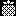

# Catálogo

Nessa catálogo são definidos os itens, equipamento e habilidades, aqui é definido as caraterísticas do objeto de catálogo.

**Pontos**
- HP -> Pontos de vida
- MP -> Pontos de magia
- EP -> Pontos de energia
- HU -> Pontos de humor
- FP -> Pontos de Alimentação

**Estados Fisicos**
- SLP - Dormindo
- PSN - Envenenado
- BRN - Queimado
- PRL - Paralizado
- FRZ - Congelado
- CNF - Confuso
- CRS - Amaldiçoado
- FND - Cançado
- HGR - Faminto
- ALL - Todos os estados (só para cura: ALL-100%)

**Estados Emocionais**
- HPY - Feliz
- SAD - Triste
- ANG - Zangado
- BRD - Entediado

**Naturezas**
- FRE - Fogo
- EAT - Terra
- WTR - Água
- AIR - Ar
- NTR - Neutro

## Itens

Os itens são objetos consumíveis, ao ser usado é decrementado a quantidade no inventário, a estrutura é:
- ID (inteiro não sinalizado)
- Ícone (referência a VROM)
- Nome (texto de 20 caracteres)
- Tipo (comida, bebida e poção/remédio)
- Efeitos Aumenta ou diminui  a pontuação (HP+10, EP+30 ) 
- Estado: Probabilidade de cura em %, (FRZ+5, PSN-100)
- Afinidade: Aumenta 1 ponto de afinidade: (FRE, EAT)
- Descrição (texto de 48 caracteres)

### Itens do catálogo

#### Frutas (1 a 8)

1. Maçã
	- Ícone: 
	- Tipo: Comida
	- Efeito: FP+15, HP+5, EP+10
	- Estado: HGR-25%
	- **Descrição:** Maca fresca, crocante e rica em fibras.
2. Banana
	- Ícone: 
	- Tipo: Comida
	- Efeito: FP+22, HU+15, EP+25, HP+4
	- **Descrição:** Banana doce e rica em potassio para energia.
3. Abacate
	- Ícone: 
	- Tipo: Comida
	- Efeito: FP+32, HU+10, EP+18, HP+10
	- **Descrição:** Abacate cremoso, nutritivo e com gordura boa.
4. Abacaxi
	- Ícone: 
	- Tipo: Comida
	- Efeito: FP+18, HU+20, EP+12, HP+8
	- **Descrição:** Abacaxi citrico e doce, melhora a digestao.
5. Uva
	- Ícone: 
	- Tipo: Comida
	- Efeito: FP+12, HU+18, EP+15, HP+6
	- **Descrição:** Cacho de uvas suculentas e antioxidantes.
6. Morango
	- Ícone: 
	- Tipo: Comida
	- Efeito: FP+10, HU+24, EP+8, HP+6
	- **Descrição:** Morango vermelho perfumado e rico em vit. C.
7. Laranja
	- Ícone: 
	- Tipo: Comida
	- Efeito: FP+14, HU+16, EP+12, HP+12
	- **Descrição:** Laranja suculenta que fortalece a imunidade.
8. Cereja
	- Ícone: 
	- Tipo: Comida
	- Efeito: FP+10, HU+22, EP+8, HP+8
	- **Descrição:** Cerejas doces que aliviam o estresse do pet.

#### Vegetais (9 a 16)

9. Cenoura
	- Ícone: 
	- Tipo: Comida
	- Efeito: FP+16, HU+8, EP+10, HP+10
	- **Descrição:** Cenoura crocante e riquissima em vitamina A.
10. Brócolis
	- Ícone: 
	- Tipo: Comida
	- Efeito: FP+20, HU+4, EP+12, HP+18
	- **Descrição:** Brocolis saudavel e repleto de ferro e calcio.
11. Ervilha
	- Ícone: 
	- Tipo: Comida
	- Efeito: FP+16, HU+6, EP+14, HP+8
	- **Descrição:** Ervilhas verdes com proteina e fibras leves.
12. Batata
	- Ícone: 
	- Tipo: Comida
	- Efeito: FP+30, HU+10, EP+28, HP+4
	- **Descrição:** Batata cozida com amido e energia duradoura.
13. Jirimum
	- Ícone: 
	- Tipo: Comida
	- Efeito: FP+22, HU+12, EP+12, HP+12
	- **Descrição:** Jirimum macio que regula o estomago do pet.
14. Cebola
	- Ícone: 
	- Tipo: Comida
	- Efeito: FP+10, HU-5, EP+15, HP+2
	- **Descrição:** Cebola ardida e picante que espanta germes.
15. Rabanete
	- Ícone: 
	- Tipo: Comida
	- Efeito: FP+12, HU+4, EP+6, HP+8
	- **Descrição:** Rabanete fresco e crocante com acao depurativa.
16. Feijões
	- Ícone: 
	- Tipo: Comida
	- Efeito: FP+35, HU+8, EP+24, HP+10
	- **Descrição:** Feijoes fartos em ferro e proteinas vegetais.

#### Bebidas (17 a 24)

17. Leite
	- Ícone: 
	- Tipo: Bebida
	- Efeito: FP+14, HU+12, EP+12, HP+14
	- **Descrição:** Leite fresco e puro com calcio fortalecedor.
18. Café
	- Ícone: 
	- Tipo: Bebida
	- Efeito: FP+4, HU+14, EP+35, HP+2
	- **Descrição:** Cafe passado quente que da muita energia.
19. Suco
	- Ícone: 
	- Tipo: Bebida
	- Efeito: FP+10, HU+18, EP+16, HP+12
	- **Descrição:** Suco natural de frutas cheio de vitaminas.
20. Refrigerante
	- Ícone: 
	- Tipo: Bebida
	- Efeito: FP+8, HU+25, EP+20
	- **Descrição:** Bebida gaseificada doce com explosao de gas.
21. Chá
	- Ícone: 
	- Tipo: Bebida
	- Efeito: FP+5, HU+12, EP+12, HP+16
	- **Descrição:** Cha de ervas que relaxa e purifica o pet.
22. Água
	- Ícone: 
	- Tipo: Bebida
	- Efeito: FP+4, HU+8, EP+10, HP+15
	- **Descrição:** Agua pura essencial para a vida e hidratacao.
23. Refresco
	- Ícone: 
	- Tipo: Bebida
	- Efeito: FP+8, HU+16, EP+14, HP+6
	- **Descrição:** Refresco gelado citrico que alivia o calor.
24. Vitamina de Banana
	- Ícone: 
	- Tipo: Bebida
	- Efeito: FP+26, HU+20, EP+28, HP+14
	- **Descrição:** Batida cremosa de banana e leite energetica.

#### Lanches (25 a 32)

25. Hambúrguer
	- Ícone: 
	- Tipo: Comida
	- Efeito: FP+38, HU+32, EP+22, HP+6
	- **Descrição:** Hamburguer com queijo e carne bem grelhada.
26. Batata Frita
	- Ícone: 
	- Tipo: Comida
	- Efeito: FP+24, HU+30, EP+20, HP+2
	- **Descrição:** Batatas crocantes e douradas com salzinho.
27. Pizza
	- Ícone: 
	- Tipo: Comida
	- Efeito: FP+40, HU+36, EP+24, HP+8
	- **Descrição:** Fatia com queijo derretido saborosa e famosa.
28. Hot Dog
	- Ícone: 
	- Tipo: Comida
	- Efeito: FP+32, HU+26, EP+20, HP+4
	- **Descrição:** Cachorro-quente com molho e salsicha macia.
29. Pipoca
	- Ícone: 
	- Tipo: Comida
	- Efeito: FP+14, HU+22, EP+14, HP+6
	- **Descrição:** Pipoca crocante estourada na manteiga e sal.
30. Taco
	- Ícone: 
	- Tipo: Comida
	- Efeito: FP+28, HU+25, EP+18, HP+8
	- **Descrição:** Tortilha crocante recheada com carne e sabor.
31. Pão
	- Ícone: 
	- Tipo: Comida
	- Efeito: FP+22, HU+14, EP+20, HP+8
	- **Descrição:** Pao macio de casca dourada assado na hora.
32. Croissant
	- Ícone: 
	- Tipo: Comida
	- Efeito: FP+24, HU+24, EP+18, HP+6
	- **Descrição:** Massa folhada amanteigada fina e crocante.

#### Carnes (33 a 40)

33. Camarão
	- Ícone: 
	- Tipo: Comida
	- Efeito: FP+26, HU+28, EP+16, HP+14
	- **Descrição:** Camarao grelhado delicado de sabor nobre.
34. Peixe
	- Ícone: 
	- Tipo: Comida
	- Efeito: FP+30, HU+22, EP+18, HP+22
	- **Descrição:** File de peixe grelhado rico em omega 3 vital.
35. Carne
	- Ícone: 
	- Tipo: Comida
	- Efeito: FP+40, HU+26, EP+22, HP+16
	- **Descrição:** Carne vermelha suculenta e rica em ferro.
36. Frango
	- Ícone: 
	- Tipo: Comida
	- Efeito: FP+34, HU+22, EP+20, HP+18
	- **Descrição:** Coxa de frango assada macia e bem dourada.
37. Pernil
	- Ícone: 
	- Tipo: Comida
	- Efeito: FP+42, HU+24, EP+20, HP+12
	- **Descrição:** Pernil suino assado com tempero marcante.
38. Bife
	- Ícone: 
	- Tipo: Comida
	- Efeito: FP+38, HU+25, EP+22, HP+15
	- **Descrição:** Bife macio grelhado no ponto com suco rico.
39. Espetinho
	- Ícone: 
	- Tipo: Comida
	- Efeito: FP+30, HU+28, EP+18, HP+12
	- **Descrição:** Espetinho na brasa com aroma de churrasco.
40. Presunto
	- Ícone: 
	- Tipo: Comida
	- Efeito: FP+26, HU+18, EP+16, HP+8
	- **Descrição:** Fatias de presunto curado de sabor refinado.

#### Sobremesas (41 a 48)

41. Bolo
	- Ícone: 
	- Tipo: Comida
	- Efeito: FP+28, HU+34, EP+20, HP+4
	- **Descrição:** Fatia fofa de bolo confeitado bem docinho.
42. Sorvete
	- Ícone: 
	- Tipo: Comida
	- Efeito: FP+16, HU+32, EP+16, HP+4
	- **Descrição:** Casquinha de sorvete cremoso e refrescante.
43. Sundae
	- Ícone: 
	- Tipo: Comida
	- Efeito: FP+24, HU+36, EP+22, HP+4
	- **Descrição:** Taca de sundae com sorvete, calda e cereja.
44. Picolé
	- Ícone: 
	- Tipo: Comida
	- Efeito: FP+8, HU+22, EP+12, HP+6
	- **Descrição:** Picole no palito geladinho contra o calor.
45. Cupcake
	- Ícone: 
	- Tipo: Comida
	- Efeito: FP+20, HU+28, EP+18, HP+4
	- **Descrição:** Bolinho decorado com cobertura doce colorida.
46. Torta
	- Ícone: 
	- Tipo: Comida
	- Efeito: FP+28, HU+30, EP+20, HP+6
	- **Descrição:** Fatia de torta caseira de massa crocante.
47. Biscoito
	- Ícone: 
	- Tipo: Comida
	- Efeito: FP+14, HU+22, EP+16, HP+4
	- **Descrição:** Biscoito crocante assado no forno.
48. Donut
	- Ícone: 
	- Tipo: Comida
	- Efeito: FP+20, HU+28, EP+20, HP+2
	- **Descrição:** Rosquinha frita fofa com cobertura.

#### Poções de Vida (49 a 52)

49. Poção
	- Ícone: 
	- Tipo: Poção
	- Efeito: HU+4, EP+5, HP+150
	- **Descrição:** Pocao basica que cicatriza ferimentos leves.
50. Super Poção
	- Ícone: 
	- Tipo: Poção
	- Efeito: HU+6, EP+10, HP+400
	- **Descrição:** Solucao concentrada que recupera bastante HP.
51. Mega Poção
	- Ícone: 
	- Tipo: Poção
	- Efeito: HU+8, EP+15, HP+1000
	- **Descrição:** Frasco magico potente de alta regeneracao.
52. Ultra Poção
	- Ícone: 
	- Tipo: Poção
	- Efeito: HU+12, EP+25, HP+2500
	- **Descrição:** Pocao suprema que restaura quase toda a vida.

#### Tônicos de Mana (53 a 56)

53. Tônico
	- Ícone: 
	- Tipo: Poção
	- Efeito: HU+4, EP+10, MP+80
	- **Descrição:** Elixir de ervas que repoe a energia magica.
54. Super Tônico
	- Ícone: 
	- Tipo: Poção
	- Efeito: HU+6, EP+15, MP+200
	- **Descrição:** Tonico aprimorado com forte carga de mana.
55. Mega Tônico
	- Ícone: 
	- Tipo: Poção
	- Efeito: HU+8, EP+20, MP+500
	- **Descrição:** Essencia arcana pura que restaura muito MP.
56. Ultra Tônico
	- Ícone: 
	- Tipo: Poção
	- Efeito: HU+12, EP+30, MP+1200
	- **Descrição:** Infusao suprema que enche as reservas de MP.

#### Remédios e Especiais (57 a 64)

57. Antídoto
	- Ícone: 
	- Tipo: Poção
	- Efeito: HU+6, EP+10, HP+30
	- Estado: PSN-100%
	- **Descrição:** Soro que purifica toxinas e neutraliza veneno.
58. Anti Paralisia
	- Ícone: 
	- Tipo: Poção
	- Efeito: HU+6, EP+20, HP+20
	- Estado: PRL-100%
	- **Descrição:** Destrava os musculos e devolve a agilidade.
59. Anti Queimadura
	- Ícone: 
	- Tipo: Poção
	- Efeito: HU+8, EP+10, HP+40
	- Estado: BRN-100%
	- **Descrição:** Balsamo refrescante que alivia pele queimada.
60. Anti Congelante
	- Ícone: 
	- Tipo: Poção
	- Efeito: HU+6, EP+25, HP+25
	- Estado: FRZ-100%
	- **Descrição:** Liquido termico que descongela o corpo do pet.
61. Anti Confusão
	- Ícone: 
	- Tipo: Poção
	- Efeito: HU+10, EP+10, HP+10, MP+30
	- Estado: CNF-100%
	- **Descrição:** Oleo aromatico que clareia a mente e o foco.
62. Despertador
	- Ícone: 
	- Tipo: Poção
	- Efeito: HU+6, EP+40, MP+20
	- Estado: SLP-100%
	- **Descrição:** Composto estimulante que acorda o pet na hora.
63. Energético
	- Ícone: 
	- Tipo: Poção
	- Efeito: HU+15, EP+60, HP+50, MP+100
	- **Descrição:** Bebida eletrizante que restaura muita estamina.
64. Elixir
	- Ícone: 
	- Tipo: Poção
	- Efeito: HU+30, EP+50, HP+1500, MP+800
	- Estado: ALL-100%
	- **Descrição:** Pocao lendaria que sara feridas e todo estado.

## Equipamentos

Os equipamentos serveme para aprimora o reduzir atributos, não são consúmíves, podeden ser equipado no slot apropriado eme Equpamento, u slote de um tipo, pode comportat apenas um por vez, sua estrura é:
- ID (inteiro não sinalizado)
- Icone (referência a VROM)
- Nome (texto de 20 caracteres)
- Tipo (cabeça, corpo, mão ATK, mão DEF, pés, acessório 1 e acessório 2)
- Efeitos (Almenta ou diminui um atributio: ATK, DEF, FOR, AGI, INT, SOR) (Pode ter mais de 1)
- Sobre efeito (Diminui ou aumenta a probabilidade de a um estado: Exemplo: ENVENENADO -20%)
- Afinidade (Fogo, Terra, Água, Ar e Neutro)
- Descrição (texto de 48 caracteres)

> TODO: Criar um catálogo de 64 itens.
## Habilidades

Aqui são descritas as habilidades possíve de se encinar a um gurá, elas são gerenciadas no menu Habilidades, sua estrutura é:
- ID (inteiro não sinalizado)
- Icone (referência a VROM)
- Nome (texto de 20 caracteres)
- Tipo (Ataque, cura ou efeito)
- Alvo (Quem a habilidade afeta, usuário ou oponente)
- Atributos (dano, cura)
- Sobre efeito (Diminui ou aumenta a probabilidade de  um estado: Exemplo: ENVENENADO +20%)
- Natureza (Determina qual natureza é compatível: Fogo, Terra, Água, Ar e Neutro)
- Descrição (texto de 48 caracteres)

> TODO: Criar um catálogo de 64 itens.