# Guará

O Guará é um *pet* virtual com elementos de RPG para um console portátil baseado em ESP32. O jogador cria uma criatura, o Guará, que precisa ser alimentada, cuidada e equipada. Ela evolui por estágios e por naturezas elementais de acordo com o modo como é criada, luta na arena e joga minijogos em Lua carregados do cartão SD. No futuro, um Guará poderá se conectar a outro para trocar itens, jogar junto e batalhar.

Este documento é a especificação do projeto. Ele descreve o hardware, os formatos de dados, a interface e as regras do jogo com detalhe suficiente para que uma pessoa ou um agente recrie o sistema. Os números de balanceamento que esta especificação deixa em aberto estão em [docs/GAME_DESIGN.md](docs/GAME_DESIGN.md), e o plano de fases e as decisões de hardware estão em [docs/PLAN.md](docs/PLAN.md).

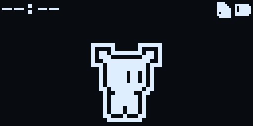

**Sumário**

1. [Hardware](#hardware)
2. [Memória e armazenamento](#memória-e-armazenamento)
3. [Firmware](#firmware)
4. [Interface](#interface)
5. [Menus](#menus)
6. [Regras do jogo](#regras-do-jogo)
7. [Sprites](#sprites)
8. [Implementação](#implementação)
9. [Licença](#licença)

___

## Hardware

### Componentes

1. **CPU:** ESP32-WROOM-32 (placa NodeMCU-32S), 4 MB de Flash.
2. **Vídeo:** display OLED monocromático de 1,3" e 128x64 px, SH1106 em I2C (endereço `0x3C`). O suporte a OLED SPI fica para revisões futuras do hardware.
3. **Áudio:** buzzer piezoelétrico acionado por transistor (buzzer + BC337 + resistor de 1 kΩ).
4. **Armazenamento:** Flash interna do ESP32 e cartão microSD em SPI (módulo Micro SD SPI TF), formatado em FAT32.
5. **Alimentação:** bateria LiPo de 3,7 V e 1200 mAh, módulo de carga TP4056 e conversor DC-DC S09 para 3,3 V (até 1100 mA).
6. **Controles:** 6 botões táteis ligados ao GND, com pull-up interno: Cima, Baixo, Esquerda, Direita, A (confirmar) e B (voltar/cancelar).
7. **Conectividade:** Wi-Fi e Bluetooth do próprio ESP32. Só o Wi-Fi está implementado.
8. **Relógio (RTC):** módulo DS3231 (I2C, endereço `0x68`) com bateria CR2032, no mesmo barramento do display. É a fonte de hora do sistema e mantém a hora no deep sleep e com a LiPo descarregada. O RTC interno do ESP32 não serve de referência: os pinos do cristal de 32 kHz (GPIO32/33) estão ocupados pelos botões, e o oscilador RC interno deriva vários minutos por hora. Sem o DS3231, o firmware usa o RTC interno e sincroniza pela rede (NTP).

### Pinagem

| # | Porta do NodeMCU | Conexão | Módulo | Descrição |
|---|---|---|---|---|
| 1 | 3V3 | OUT+ | S09 DC-DC | Alimentação de 3,3 V regulada |
| 2 | GND | GND | Todos | Terra comum |
| 3 | GPIO15 | — | — | Livre |
| 4 | GPIO2 | — | — | Livre |
| 5 | GPIO4 | — | — | Livre (reservado para o INT/SQW do DS3231, decisão D10) |
| 6 | GPIO16 | — | — | Livre |
| 7 | GPIO17 | — | — | Livre |
| 8 | GPIO5 / VSPI_CS | CS | Micro SD | Chip select do cartão |
| 9 | GPIO18 / VSPI_CLK | SCK | Micro SD | Clock do SPI |
| 10 | GPIO19 / VSPI_MISO | MISO | Micro SD | Dados do cartão para o ESP32 |
| 11 | GPIO21 | SDA | SH1106 / DS3231 | Dados do I2C (400 kHz, compartilhado) |
| 12 | GPIO3 / U0_RXD | RX | USB-serial | UART0: gravação e console de depuração |
| 13 | GPIO1 / U0_TXD | TX | USB-serial | UART0: log |
| 14 | GPIO22 | SCL | SH1106 / DS3231 | Clock do I2C |
| 15 | GPIO23 / VSPI_MOSI | MOSI | Micro SD | Dados do ESP32 para o cartão |
| 16 | EN | — | — | Reset |
| 17 | GPIO36 | — | — | Livre |
| 18 | GPIO39 | — | — | Livre |
| 19 | GPIO34 / ADC1_6 | Divisor 100 kΩ / 100 kΩ | Bateria | Tensão da LiPo (ADC1 funciona com o Wi-Fi ligado) |
| 20 | GPIO35 / ADC1_7 | CHRG (pull-up externo de 100 kΩ) | TP4056 | Nível baixo enquanto carrega (o GPIO35 não tem pull-up interno) |
| 21 | GPIO32 | Botão Cima | Controles | Pino RTC: acorda do deep sleep |
| 22 | GPIO33 | Botão Baixo | Controles | Pino RTC: acorda do deep sleep |
| 23 | GPIO25 | Base do transistor | Buzzer | PWM do LEDC (timer 0, canal 0) |
| 24 | GPIO26 | Botão B | Controles | Pino RTC: acorda do deep sleep |
| 25 | GPIO27 | Botão Direita | Controles | Move para a direita de quem olha (+X) |
| 26 | GPIO14 | Botão Esquerda | Controles | Move para a esquerda de quem olha (−X) |
| 27 | GPIO12 | — | — | Livre; *strapping* MTDI, precisa estar em nível baixo no boot |
| 28 | GPIO13 | Botão A | Controles | Pino RTC: acorda do deep sleep |
| 29 | GND | GND | Todos | Terra comum |
| 30 | VIN | IN+ | TP4056 / USB | Entrada de 5 V |

O mapeamento fica em `src/hal/pins.h`.

### Montagem

O VIN do NodeMCU vai ao módulo de carga e o 3V3 à saída do S09. Por isso o regulador de tensão do NodeMCU é removido, junto com o LED de alimentação. O mesmo vale para o módulo microSD, se ele tiver regulador. Os LEDs indicadores de todos os módulos são removidos, menos o de carga.

O protótipo é montado numa estrutura impressa em 3D, com os módulos ligados por cabos paralelos no estilo IDE. Depois será feita uma PCB para todos os módulos.

### Energia e bateria

- **Detecção de carga:** o pino CHRG do TP4056 (GPIO35) fica em nível baixo enquanto a bateria carrega. Com a carga completa ele volta ao nível alto, então o sistema mostra só a porcentagem.
- **Leitura da bateria:** divisor resistivo de 100 kΩ / 100 kΩ no GPIO34 (ADC1, canal 6), com calibração do ADC e média móvel.
- **Curva de descarga:** mapeamento não linear entre 3,27 V (0%) e 4,20 V (100%).
- **Modos de operação:**
	1. **Ativo:** CPU em 160 MHz, telas a 20 FPS (30 FPS em jogos, combate e cronômetro).
	2. **Ocioso:** entra após **30 s** sem nenhum botão.
		- O brilho do display cai para o mínimo e as telas são desenhadas a no máximo **5 FPS** (a animação do Guará já roda a 3 FPS).
		- A CPU varia entre 80 e 160 MHz (frequência dinâmica do ESP-IDF) e entra em *light sleep* automático sempre que não há tarefa para executar. O barramento APB fica em 80 MHz, então UART, LEDC e I2C não mudam de clock.
		- Os botões passam a ser lidos a cada 20 ms em vez de 5 ms.
		- Enquanto o buzzer toca, o *light sleep* fica bloqueado, porque o LEDC para no *light sleep*. A música continua tocando no modo Ocioso.
		- As telas que impedem o deep sleep (jogos, combate, cronômetro e alarme tocando) também impedem o modo Ocioso.
		- O primeiro toque em qualquer botão só volta ao modo Ativo, sem agir na tela; a tecla é ignorada até ser solta.
		- O modo Ocioso não depende da configuração de Economia e vale também com o USB ligado.
	3. **Deep sleep:** entra após o tempo de **Economia** sem uso (Ajustes > Energia: 1, 2, 5 ou 10 min, ou desativado). Antes de dormir, o sistema grava o save pendente, desmonta o cartão SD e desliga o Wi-Fi. A CPU e os rádios desligam; ficam ligados o domínio RTC e a RTC RAM, com o estado do Guará. O display fica desligado (comando `0xAE`).
		> ⏳ Pendente (decisão D7 em `docs/PLAN.md`): o consumo real em deep sleep ainda precisa ser medido. Com a montagem atual (divisor da bateria ligado direto, conversor USB-serial do NodeMCU, OLED e SD sem corte de energia), ele fica bem acima dos ~10 µA do ESP32 sozinho.
	4. **Despertar:** pelos botões Cima, Baixo, A e B, ou pelo timer, no horário do próximo despertador ou do fim do temporizador.
		- O coprocessador **ULP** confere os quatro botões a cada ~20–30 ms e acorda o chip quando um deles vai a nível baixo. No ESP32, o `ext1` só acorda com "todos os pinos em nível baixo" ou "algum pino em nível alto", o que não serve para vários botões ligados ao GND, e o `ext0` não pode ser usado junto com o ULP. Se o ULP falhar, o Cima volta a acordar pelo `ext0`. Esquerda e Direita não acordam o aparelho.
		- Antes de dormir, todas as fontes de despertar são limpas (o *light sleep* automático deixa o timer e a UART ligados), e o display só é desligado depois de terminar a transmissão em andamento. Um corte no meio de um byte deixaria o SH1106 segurando o SDA. No boot, um SDA preso é destravado com até 9 pulsos no SCL e uma condição de STOP.
		- O timer do deep sleep usa o oscilador RC interno e pode atrasar despertadores longos (decisão D10, pendente).
- **Bateria crítica:** três leituras seguidas abaixo de 10% (3,45 V) sem carregar disparam um salvamento de emergência na Flash, o aviso "Bateria fraca / Conecte o carregador" por 3 s e um deep sleep sem timer.
- **Recuperação temporal:** no boot e ao acordar, o sistema carrega o último save válido (da RTC RAM ou da Flash), calcula o tempo decorrido (Δt) entre a hora atual e o horário do save e simula o ciclo de vida minuto a minuto, até 7 dias. Durante essa simulação, travas impedem que o HP fique abaixo de 20% e os vitais abaixo de 5%, para o Guará não desmaiar sem chance de reação.

___

## Memória e armazenamento

### Partições

A Flash de 4 MB é dividida pela tabela `partitions.csv`:

| Partição | Tipo | Subtipo | Offset | Tamanho | Conteúdo |
|---|---|---|---|---|---|
| `nvs` | data | nvs | 0x9000 | 20 KB | Configurações (Wi-Fi e redes salvas, mudo, volume, economia, hora de dormir e de acordar, fuso horário) |
| `otadata` | data | ota | 0xE000 | 8 KB | Qual partição OTA está ativa |
| `ota_0` | app | ota_0 | 0x10000 | 1472 KB | Firmware ativo |
| `ota_1` | app | ota_1 | 0x180000 | 1472 KB | Firmware secundário, para atualização segura com *rollback* |
| `storage` | data | 0x99 | 0x2F0000 | 1024 KB | VROM e catálogo, **somente leitura** |
| `save` | data | 0x9A | 0x3F0000 | 8 KB | Anel de saves |

O cartão microSD (FAT32, montado em `/sdcard`) guarda o conteúdo do usuário: jogos, músicas MIDI, livros, imagens, despertadores e arquivos de atualização.

### Três camadas independentes

1. **Firmware** (`ota_0`/`ota_1`): o código C compilado com o PlatformIO, incluindo drivers, interface, regras do jogo, combate e a VM Lua. É atualizado por USB ou pelo cartão SD sem tocar nas outras partições.
2. **Dados** (`storage`): a VROM (todos os bitmaps 1-bit) e o catálogo binário (itens, equipamentos e habilidades), gerados pelo `tools/storage-packer/pack_storage.py`. A partição é mapeada na memória com `esp_partition_mmap` e lida direto da Flash, sem cópia para a RAM. Pode ser regravada sem recompilar o firmware e sem apagar o Guará.
3. **Jogador** (`save` e `nvs`): o save state e as configurações. Só são apagados pela opção **Reiniciar** de Ajustes ou por uma gravação completa da Flash.

### Proteção da Flash: os 3 pilares

A Flash suporta cerca de 100.000 ciclos de gravação por setor. Para não desgastá-la, o save segue três pilares:

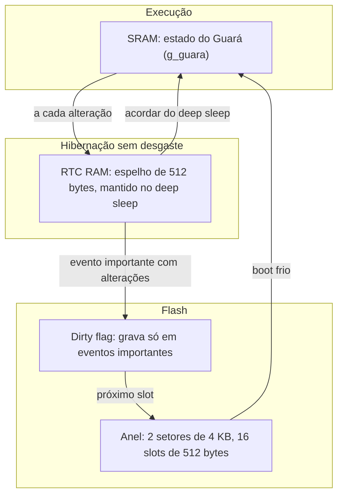

1. **RTC RAM:** toda alteração no Guará é espelhada na RTC RAM (`RTC_DATA_ATTR`), que sobrevive ao deep sleep. A rotina normal (alimentar, brincar, dormir) não grava na Flash.
2. **Gravação por eventos:** a gravação na Flash acontece só quando há alterações pendentes (*dirty flag*) e ocorre um destes eventos: voltar ao menu principal ou à tela principal, subir de nível, evoluir, desmaiar, entrar em deep sleep ou bateria crítica.
3. **Anel com nivelamento de desgaste:** a partição `save` tem 2 setores de 4 KB com 8 slots de 512 bytes cada, 16 slots no total. Cada gravação usa o próximo slot, e um setor só é apagado quando o anel volta a ele. No boot vale o slot com CRC válido e o maior contador de gravações. Isso multiplica a vida útil por 16: cerca de 1.600.000 gravações.

### Formato do `storage.bin`

Gerado por `tools/storage-packer/pack_storage.py` e lido por `lib/core/src/storage.c`. Tudo em *little-endian*; o espaço não usado fica com `0xFF`, o valor da Flash apagada. Qualquer mudança neste formato precisa ser feita no packer, no leitor do firmware e neste README.

| Offset | Bloco | Conteúdo |
|---|---|---|
| 0x00 | Cabeçalho (64 bytes) | `GSTR` (4), versão do formato = 2 (u16), flags (u16), offset da VROM (u32), tamanho da VROM (u32), offset do catálogo (u32), tamanho do catálogo (u32), 36 bytes reservados, CRC32 dos 60 bytes anteriores (u32) |
| 0x40 | VROM | Cabeçalho `GVRO` (4), número de bitmaps (u32), tamanho de cada entrada do índice = 44 (u32), tamanho dos dados (u32); índice; dados dos bitmaps |
| alinhado a 4 bytes | Catálogo | Cabeçalho `GCAT` (4), versão = 1 (u16), tamanho do registro = 176 (u16), número de itens, de equipamentos e de habilidades (u16 cada), reservado (u16); registros |

**Índice da VROM:** uma entrada de 44 bytes por bitmap, ordenada pelo nome em bytes UTF-8, para busca binária: nome (32 bytes, terminado em zero), largura (u16), altura (u16), offset dos pixels a partir do início dos dados (u32) e tamanho em bytes (u32). Os pixels ficam em linhas (*row-major*), cada linha com `ceil(largura / 8)` bytes, bit mais significativo primeiro, 1 = pixel aceso.

- O nome do bitmap é o nome do arquivo sem `.bmp`, com até 31 bytes. A pasta não faz parte do nome, então os nomes precisam ser únicos em toda a pasta `bitmaps/`.
- Entram todos os `.bmp` de `bitmaps/` e das subpastas, menos os de `bitmaps/exemple/` (capturas e mockups). Outros formatos, como PNG, são ignorados.
- O packer só aceita BMP de 1 bit (paleta de 2 cores) e falha em nomes duplicados.

**Registro do catálogo (176 bytes)**, igual para itens, equipamentos e habilidades:

| Offset | Campo |
|---|---|
| 0 | id, tipo, natureza/afinidade, alvo, poder, custo de MP, número de efeitos, número de sobre-efeitos (u8 cada) |
| 8 | 4 efeitos: alvo (u8), preenchimento (u8), valor (i16) |
| 24 | 2 sobre-efeitos: estado (u8), valor (i8, em %) |
| 28 | 4 bytes reservados |
| 32 | slug (16 bytes), ícone (32 bytes, nome na VROM), nome (32 bytes), descrição (64 bytes), textos em UTF-8 terminados em zero |

Os registros ficam em sequência: primeiro os itens, depois os equipamentos e as habilidades. O registro do item N é o N-ésimo da sua tabela, então a leitura é direta pelo ID.

### Catálogo

O catálogo é definido pelo autor em [CATALOG.md](CATALOG.md) e convertido para `catalog/items.csv`, `catalog/equipment.csv` e `catalog/skills.csv`, que o packer lê. Cada catálogo tem até 64 registros, com IDs sequenciais a partir de 0.

| Coluna | Itens | Equipamentos | Habilidades |
|---|---|---|---|
| `id`, `slug` | ID numérico; identificador textual (até 15 caracteres, usado pelos jogos Lua) | igual | igual |
| `name`, `description` | até 20 e 48 caracteres | igual | igual |
| `icon` | nome de um bitmap da VROM | igual | igual |
| `type` | `FOOD`, `DRINK`, `POTION` | `HEAD`, `BODY`, `HAND_ATK`, `HAND_DEF`, `FEET`, `ACCESSORY` | `ATTACK`, `HEAL`, `EFFECT` |
| `affinity` / `nature` | `FIRE`, `EARTH`, `WATER`, `AIR`, `NEUTRAL` | igual | qualquer natureza |
| `effects` | até 4 modificadores `ALVO±valor` separados por `;`, entre −9999 e 9999. Alvos: `HP`, `MP`, `ENERGY`, `MOOD`, `SATIETY`, `HEALTH`, `ATK`, `DEF`, `STR`, `AGI`, `INT`, `LUK` | igual | — (usa `power` e `mp_cost`) |
| `status_effects` | até 2 `ESTADO±%`; valor negativo é chance de cura (`POISONED-100`), `ALL-100` cura todos | igual | chance (%) de aplicar o estado |
| `target` | — | — | `USER` ou `OPPONENT` |

Os nomes dos estados são `SLEEPING`, `FAINTED`, `POISONED`, `PARALYZED`, `BURNED`, `FROZEN`, `CONFUSED`, `CURSED`, `TIRED`, `HUNGRY`, `HAPPY`, `SAD`, `ANGRY` e `BORED`. As enumerações estão em `lib/core/src/types.h` e precisam bater com as do packer.

O **catálogo** é o conjunto de objetos que existem no jogo e não muda durante o uso. O **inventário** é o que o jogador possui: a quantidade de cada item, indexada pelo ID, e as máscaras de equipamentos e habilidades possuídos, todos no save state.

### Save state (512 bytes)

Bloco fixo serializado por `lib/core/src/save.c`, com os domínios em offsets fixos. São 190 bytes úteis; o resto fica reservado:

| Offset | Domínio | Tamanho | Conteúdo |
|---|---|---|---|
| 0 | Header | 16 | Magic `GUARA` (5 bytes), versão do formato (u8), flags (u16), horário UNIX do save (u32), contador de gravações (u32) |
| 16 | Identity | 20 | Nome (10 caracteres + terminador), UID (u32), variante da cabeça (1..9), cor (0 preto, 1 branco), natureza de nascimento, natureza atual, estágio (0..4) |
| 36 | Vitals | 16 | HP, HP máximo, MP, MP máximo (u16); Energia, Humor, Alimentação, Saúde em centésimos de % (u16, 10000 = 100%) |
| 52 | Stats | 21 | Nível (u8), XP (u32), idade em minutos (u32), ATK, DEF, FOR, AGI, INT, SOR (u16) |
| 73 | Gauges | 8 | Medidores ocultos (4 × i16, de −10000 a 10000): Vitórias × Derrotas, Cuidado × Negligência, Raiva × Tristeza, Dia × Noite |
| 81 | Affinities | 10 | Afinidades em centésimos de % (Fogo, Terra, Água, Ar, Neutro) |
| 91 | Inventory | 64 | Quantidade (0..255) de cada item, indexada pelo ID |
| 155 | Equipment | 15 | Máscara dos 64 equipamentos possuídos (8 bytes) e IDs dos 7 slots equipados (`0xFF` = vazio) |
| 170 | Skills | 12 | Máscara das 64 habilidades possuídas (8 bytes) e as 4 habilidades ativas |
| 182 | StatusFlags | 8 | Máscara de estados (u32), minutos desmaiado (u16), minutos sem interação (u16) |
| 190 | Reservado | 318 | Zeros |
| 508 | Checksum | 4 | CRC32 dos 508 bytes anteriores; saves corrompidos são descartados |

A máscara de estados usa o bit N para o estado N de `types.h`. O bit 10 (`ST_RECOVERING`) é interno: indica que a recuperação de HP está ligada (ver *Desgaste*).

___

## Firmware

### Ambiente de desenvolvimento

- **Build:** PlatformIO (`platformio.ini` na raiz), plataforma `espressif32@7.1.3`, placa `nodemcu-32s`.
- **Framework:** ESP-IDF 6.1 puro (`framework = espidf`), com FreeRTOS e drivers próprios. O Arduino não é usado.
- **Lua:** Lua 5.4.7 incorporado em `lib/lua`, compilado com `LUA_32BITS` e sem as bibliotecas `io`, `os`, `package` e `debug`.
- **Ambientes:** `esp32` (firmware) e `native` (testes unitários da lógica no computador, com Unity).
- **`sdkconfig.defaults`:** tabela de partições própria, `FREERTOS_HZ=1000`, pilha da task principal de 16 KB, nomes longos em UTF-8 no FAT, gerenciamento de energia (`PM_ENABLE`, `FREERTOS_USE_TICKLESS_IDLE`) e ULP FSM com 128 bytes reservados.
- **Serial:** 115200 baud pela UART0.

### Comandos

O `pio` fica em `~/.platformio/penv/bin/pio` quando instalado pela extensão PlatformIO IDE.

```bash
pio run -e esp32                          # compila o firmware (sem warnings, com -Wshadow)
pio run -e esp32 -t upload                # grava bootloader, tabela de partições e firmware
pio run -e esp32 -t upload_storage        # gera e grava só a partição storage (VROM + catálogo)
pio run -e esp32 -t build_storage         # só gera .pio/storage.bin
pio run -e esp32 -t monitor               # monitor serial
pio test -e native                        # testes no computador (test_crc32, test_gfx, test_core, test_midi_ini)
```

Gravar o firmware ou o storage nunca apaga as partições `save` e `nvs`.

### Ferramentas

- **`tools/storage-packer/pack_storage.py`:** monta o `storage.bin` a partir de `bitmaps/` e `catalog/` e valida tudo: BMP de 1 bit, nomes únicos, ícones existentes, IDs sequenciais, textos dentro dos limites. O alvo `upload_storage` do PlatformIO (script `tools/pio_storage.py`) chama o packer e grava só a partição. Os testes usam um catálogo próprio em `test/fixtures/catalog/`, empacotado por `tools/pio_storage_test.py`.
- **`tools/bmp-builder/bmp_builder.py`:** converte PNG, JPG, WebP, GIF, SVG ou BMP para o BMP canônico do Guará (2 cores, índice 0 = preto, índice 1 = branco, linhas alinhadas a 4 bytes, de baixo para cima). Tem os *presets* `icon` (16x16), `sprite` (32x32), `mannequin` (32x56), `boss` (64x64) e `screen` (128x64), métodos de binarização (`threshold`, `otsu`, `floyd-steinberg`, `atkinson`, `bayer`) e `-p` para pré-visualizar no terminal. Uma versão em C++ compila com `make` em `tools/bmp-builder`.
- **`tools/font-builder/build_font.py`:** gera `lib/gfx/src/font_5x8.c` a partir do desenho em `font_5x8.txt` (fonte 5x8 com acentos do português).
- **`tools/console.py`:** console de depuração pela serial. Envia teclas (`w` `s` `a` `d` = direcional, `j` = A, `k` = B), captura a tela (`P`), mostra o estado do Guará (`S`) e coloca o aparelho em deep sleep (`Z`). Neste adaptador USB, abrir a porta reinicia o ESP32, então o modo `script` executa vários passos numa só conexão. As capturas saem em PNG ou, com extensão `.bmp`, no formato das imagens de `bitmaps/exemple/` (512x256 em RGB565).

```bash
python3 tools/console.py script "wait 4" "keys jd" "screen tela.bmp" "state"
python3 tools/console.py script "wait 4" "sleep" "log 60"     # dorme e mostra o log ao acordar
```

O console nunca abre a porta com o DTR ativo, porque o GPIO0 iria a nível baixo e a placa entraria em modo de gravação. No modo Ocioso, o chip acorda pelos bytes recebidos, que se perdem; por isso o `console.py` manda um preâmbulo antes de cada comando.

### Organização do código

- **`lib/`:** C11 puro, sem includes do ESP-IDF, compilado para o aparelho e para os testes:
	- `crc32`;
	- `gfx`: framebuffer no formato de páginas do SH1106, primitivas, texto UTF-8, modos de desenho e decodificador de BMP;
	- `core`: tipos, leitor do storage (VROM e catálogo), formato e anel de saves, ciclo de vida do Guará (`guara.c`), combate (`combat.c`) e os números de balanceamento (`rules.h`);
	- `midi`: leitor de arquivos MIDI (SMF) reduzido a uma voz;
	- `ini`: leitor de arquivos `.ini`;
	- `lua`: Lua 5.4.7.
- **`src/`:** componente principal do ESP-IDF, só com código de hardware e de interface:
	- `hal/`: drivers. `display` (SH1106; uma task envia só as páginas alteradas), `buttons` (fila de eventos com *debounce* e repetição), `audio` (task do LEDC com efeitos e música de fundo), `battery`, `sdcard`, `rtc_clock` (DS3231, NTP e fuso), `power` (modo Ocioso, deep sleep e ULP), `wifi`, `i2c` e `pins.h`;
	- `system/`: serviços. `app` (boot, laço principal, ciclo de vida por minuto, modo Ocioso, inatividade, bateria crítica), `persistence` (storage, anel de saves, espelho na RTC RAM), `config` (NVS), `network` (Wi-Fi sob demanda), `alarms`, `ota` e `debug_console`;
	- `ui/`: pilha de telas (`ui.h`), componentes padrão (`widgets.h`), modais e teclado virtual (`modal.h`);
	- `screens/`: um arquivo por tela; `screens.h` lista todas, `submenu.h` monta sub-menus padrão e `sprite.h` compõe o Guará. A API Lua fica em `games.c` (VM e módulos básicos) e `game_api.c` (desenho da VROM, `catalog`, `ui` e `guara.draw`).

**Telas:** cada tela é um `screen_t` com os callbacks `on_open`, `on_resume`, `on_close`, `on_key` e `on_draw`, empilhado por `ui_open` e removido por `ui_back`. Telas reutilizáveis que podem se empilhar (modais, sub-menus) guardam estado por camada, indexado por `ui_current_layer()`. O resultado de um modal chega por um callback *depois* que o modal sai da pilha, então o callback pode abrir outras telas. Quem altera o Guará chama `app_mark_changed()`, que espelha na RTC RAM e marca o *dirty flag*.

**Laço principal (`app_run`):** lê as teclas, desenha a tela do topo na taxa dela (20 FPS por padrão, 30 FPS em jogos, combate e cronômetro, no máximo 5 FPS no modo Ocioso), confere a cada segundo bateria, despertadores, temporizador, inatividade e modo Ocioso, e roda o ciclo de vida do Guará a cada minuto.

**Regras de compilação:** o ESP-IDF compila com `-Werror`; `-Wno-format-truncation` é intencional (os `snprintf` truncam de propósito em buffers fixos) e `-Wshadow` fica ligado como aviso.

### Versionamento

Versão no formato `v#.#.#` (lançamento.funcionalidade.correção), definida em `-DGUARA_VERSION` no `platformio.ini`, com o histórico em [CHANGELOG.md](CHANGELOG.md):

- **Correção (`#.#.+1`):** ajustes e correções no firmware ou no storage.
- **Funcionalidade (`#.+1.0`):** novas funcionalidades, mecânicas ou itens no catálogo.
- **Lançamento (`+1.0.0`):** versões oficiais.
- A versão só muda com alterações no firmware ou no storage (VROM, catálogo, formato do save). Mudanças só na documentação geram apenas um commit.
- **Versões `0.x.x`:** o Guará tem todo o catálogo liberado, com todos os itens com 255 unidades e todos os equipamentos e habilidades possuídos. A liberação acontece no nascimento e a cada boot, para facilitar os testes (`guara_is_development_version` e `guara_unlock_catalog`). A regra deixa de valer a partir da `1.0.0`.

### Wi-Fi sob demanda

Implementação: `src/system/network.c`. O rádio só liga quando alguma tarefa precisa de rede; para o usuário, o Wi-Fi continua simplesmente "ligado".

- **`ON` e `OFF` (Ajustes > Wi-Fi):** `ON` quer dizer **rede permitida**, não rádio ligado. Fora das tarefas de rede, o rádio fica desligado e o driver descarregado, o que economiza bateria e libera cerca de 60 KB de RAM. `OFF` proíbe qualquer uso de rede.
- **Contador de uso:** quem precisa de rede pede acesso (`network_use()`), espera a conexão (`network_wait()`) e devolve ao terminar (`network_release()`).
	- No primeiro pedido, o serviço liga o rádio e conecta à última rede salva disponível.
	- Quando o contador volta a zero, o rádio desliga após **30 s** ocioso, para tarefas próximas aproveitarem a mesma conexão.
	- Tarefas em segundo plano usam `network_run()`. As telas nunca chamam o driver `wifi_*` direto.
- **Reconexão rápida:** o canal e o BSSID do último roteador ficam na NVS, e a conexão leva de 1 a 2 s em vez de 3 a 5 s com busca completa.
- **Relógio (NTP):** no boot, em segundo plano, se a hora for inválida ou a última sincronização tiver mais de **24 h**; depois, a cada 24 h com o aparelho acordado. O fuso horário fica fixo em UTC−3 (`<-03>3`), sem menu para trocar por enquanto.
- **Deep sleep:** o rádio é sempre desligado antes de dormir, e o comportamento é o mesmo no boot frio e ao acordar.
- **Jogos e tarefas pesadas:** `network_suspend()` descarrega o Wi-Fi enquanto um jogo Lua roda, para liberar memória.
- **Indicador na barra superior:** ícone de Wi-Fi apagado (xadrez) quando a rede está permitida e ociosa; barras subindo durante a conexão; barras de sinal (`wifi_1` a `wifi_3`) conectado; nenhum ícone com o Wi-Fi em `OFF`.
- **Quem usa a rede:** sincronização NTP (automática e em Relógio > Configurar) e busca, conexão e status em Ajustes > Wi-Fi. Atualização pelo GitHub e combate online estão previstos.

___

## Interface

### Padrões do sistema

As capturas desta seção estão em `bitmaps/exemple/`, ampliadas 4x (512x256).

- **Referência de lados:** neste documento, "direita" e "esquerda" são do ponto de vista do **aparelho**: a direita do aparelho é a esquerda de quem olha a tela. As coordenadas de pixel são de tela: X=0 na borda esquerda de quem olha e Y=0 no topo. **Exceção:** os botões direcionais Direita e Esquerda indicam a direção do movimento na tela, do ponto de vista de quem olha (Direita move o cursor para +X). No código, `KEY_LEFT` e `KEY_RIGHT` são direções de tela.
- **Fonte:** 5x8 px com acentos do português, linhas de 9 px.
- **Barra de título:** branca com letras pretas, **11 px de altura (Y=0..10)**, texto centralizado a partir de Y=2. Títulos que não cabem rolam com o efeito *marquee*. Nem toda tela tem barra de título.
- **Abas:** fundo preto, contorno e texto brancos, com os cantos superiores de cada aba arredondados. A barra de abas tem a mesma altura da barra de título (11 px), texto em Y=2 e 1 px de folga até o contorno e até a linha de base. Abas não selecionadas mostram até 4 caracteres; a selecionada fica com fundo branco e texto preto, com até 10 caracteres e *marquee* se for maior. Se as abas não couberem na tela, a ponta que sai da tela mostra uma pequena seta preenchida, cobrindo o conteúdo atrás. ←/→ trocam de aba.

	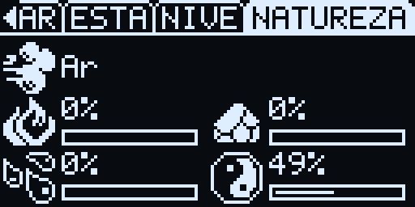

- **Barra de rolagem:** 1 px de largura na última coluna (X=127), abaixo da barra de título ou de abas, preta com um traço branco que representa a parte visível. O conteúdo nunca encosta nela: sempre há pelo menos 1 px livre.
- **Sub-menu:** todos os sub-menus usam a mesma interface. Barra de título ou de abas no topo (Y=0..10), 1 px livre (Y=11) e uma lista de **3 linhas visíveis** a partir de Y=12, cada uma com caixa de 16 px de altura e 2 px entre as caixas (uma linha a cada 18 px). Cada linha tem: 2 px, ícone 16x16, 2 px, texto, 4 px, informação à direita (até 4 caracteres, como `100%`, `ON`, `OFF`, `OK`, `DIR`, `x255`), 2 px e a barra de rolagem. A seleção é um **retângulo de cantos arredondados sem preenchimento** (contorno branco de 1 px, raio de 2 px, 124 px de largura e 16 px de altura, terminando a 1 px da barra de rolagem). Textos que não cabem são truncados e, na linha selecionada, rolam com *marquee* até o fim, pausam e recomeçam. ↑/↓ movem a seleção (com repetição ao segurar), A abre o item e B volta.

	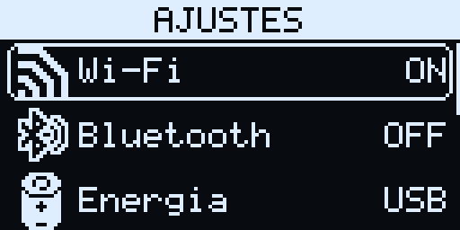

- **Rodapé:** só aparece nas telas que o pedem. Ocupa a faixa Y=54..63 com fundo preto, separado por uma linha branca em Y=53, e fica por cima do conteúdo que rola. Segue a disposição física dos botões (B à esquerda de quem olha, A à direita), com os sprites de 10x10  e :
	- **Tela cheia:** B em X=2, Y=54 e A em X=116, Y=54.
	- **Modal:** B em X=11, Y=47 e A em X=107, Y=47.
	- As legendas ficam a 3 px dos sprites, sem divisória central (cerca de 47 px para cada lado na tela cheia e 38 px no modal). Os sprites são fixos; só as legendas longas rolam com *marquee*. Use termos curtos: "VOLTAR", "SAIR", "NAO" para B; "OK", "SIM", "SALVAR", "INICIAR" para A.

	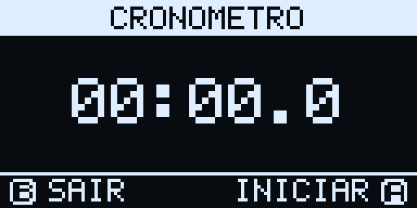

- **Modal:** desenhado por cima da tela que o chamou, com 112 x 52 px (X=8..119, Y=6..57), contorno branco de 1 px e sombra preta de **2 px** ao redor. A barra de título é igual à das telas (branca, 11 px, *marquee*); o corpo começa 1 px abaixo dela.
	- **Alerta e confirmação:** ícone 16x16 opcional e mensagem centralizada de até 3 linhas, com rodapé de modal (linha divisória em Y=45). Na confirmação, B responde "não" e A "sim".
	- **Escolha:** sem rodapé, linhas de 11 px com até 3 opções visíveis, seleção em retângulo arredondado vazado e barra de rolagem; até 16 opções.
	- **Detalhes:** sem rodapé, 4 linhas visíveis de texto com rolagem por ↑/↓.
	- **Quantidade:** escolhe um número entre um mínimo e um máximo. ↑ ou → somam 1 e ↓ ou ← tiram 1, dando a volta nos limites; segurando, o passo vira 5 e para no limite.

	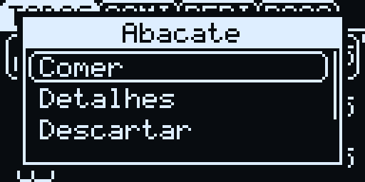 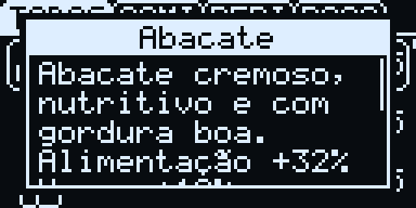 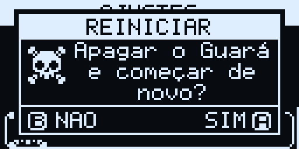

- **Teclado virtual:** grade com três páginas, `ABC` (maiúsculas), `abc` (minúsculas) e `123` (números e símbolos), e a linha de atalhos página, `ESPACO`, `APAGAR` e `OK`. Os direcionais movem o cursor, A digita a tecla ou aciona o atalho e B cancela. É usado no nome do Guará, nas senhas de Wi-Fi e para renomear arquivos.

	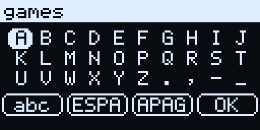

- **Comportamento padrão:** B, "voltar" ou o fim de uma ação sempre retornam à tela anterior pelo caminho inverso, com a mesma posição e o mesmo item selecionado. Exemplo: depois de comer um item, a animação aparece na tela principal e o inventário volta com o item ainda selecionado.

### Boot

Ao ligar, aparece no centro o logo  com uma barra de progresso embaixo. O boot carrega as configurações, o storage, o relógio, os botões, a bateria, o cartão SD e o save, e permanece 1 s na tela depois de concluído. Se houver Wi-Fi configurado, a hora é atualizada em segundo plano, sem prender o boot. Ao acordar do deep sleep, a tela de boot não aparece.

Se o storage estiver ausente ou corrompido, o boot mostra o erro por 3 s e segue sem gráficos nem catálogo.

### Nascimento

No primeiro boot, ou depois de Ajustes > Reiniciar, o teclado virtual pede o nome do Guará (até 10 letras). O sistema sorteia uma natureza primária (Fogo, Terra, Água ou Ar), uma cor (preta ou branca) e uma das 9 cabeças, e um alerta anuncia "*Nome* nasceu! Natureza: *natureza*". O Guará começa no nível 1, com 0 XP.

### Tela principal

Mostra o Guará e suas animações, a barra superior e o balão de estados. A abre o menu principal.


- **Barra superior:** no canto superior direito do aparelho (esquerda de quem olha, X=1, Y=1), o relógio `HH:MM`, ou `--:--` se a hora não estiver configurada. No canto oposto, da borda para o centro, os indicadores de 8x8 px:
	- **Bateria:**    , um nível a cada 25%. Carregando, os níveis se alternam a cada 0,5 s; sem bateria detectada, .
	- **Wi-Fi:**   , conforme *Wi-Fi sob demanda*.
	- **Bluetooth**  (ligado), **Despertador**  (algum despertador salvo), **Temporizador**  (contando) e **Mudo** .
- **Área do Guará:** o sprite composto (ver *Sprites*) ampliado 2x, centralizado em X=64, com a base em Y=61 (2 px acima da borda inferior).
- **Balão de estados:** do lado direito do aparelho (esquerda de quem olha, X=18, Y=14), o balão  com o ícone do estado ou da emoção dentro, 2 px abaixo do topo do balão. O balão "respira": desce 8 px e volta suavemente num ciclo de 3 s. Estados físicos aparecem sempre; as emoções seguem as regras de exibição de [docs/GAME_DESIGN.md](docs/GAME_DESIGN.md).
- **Área de itens:** do lado esquerdo do aparelho (direita de quem olha, X=100, Y=34). Ao usar um item, a tela principal aparece com a animação e depois volta para onde estava; a animação não pode ser interrompida.
	- **Comida:** o ícone aparece e, a cada 450 ms, é coberto por uma das mordidas      em modo máscara: o preto da mordida apaga a comida e o branco é transparente. Cada mordida toca um som no buzzer e deixa o Guará com o olhar feliz por meio quadro.
	- **Bebidas, poções e remédios:** o ícone pisca cada vez mais rápido por 1,6 s até sumir.
	- Depois do uso, o Guará dá uma piscadela por 1,5 s.

### Menu principal

Um carrossel com os 12 menus. No centro fica o ícone do menu selecionado ampliado 2x; dos lados, os ícones vizinhos em 1x, a 40 px de distância, e setas apontando para fora nas bordas. Embaixo, o nome do menu numa caixa branca (Y=44) e uma linha de pontos, um por menu, com o selecionado destacado (Y=58). ←/→ giram o carrossel com uma animação de 160 ms, em que o ícone que sai do centro diminui para 1x e o que chega aumenta para 2x. A abre o menu e B volta à tela principal.

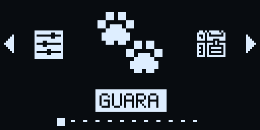

A ordem é: Guará, Inventário, Equipamentos, Habilidades, Arena, Biblioteca, Jogos, Músicas, Imagens, Relógio, Cartão SD e Ajustes. Ao voltar de um menu com alterações pendentes, o save é gravado na Flash.

___

## Menus

### Guará 

Tela com quatro abas, GUARA, ESTADO, NIVEL e NATUREZA, trocadas com ←/→. B volta.

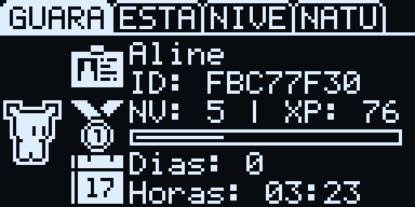 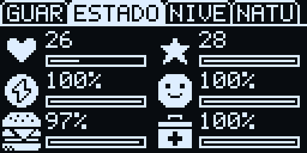

- **GUARA:** à esquerda, o Guará animado em 1x; à direita, três linhas:
	-  nome e, embaixo, o UID (`ID: A1B2C3D4`);
	-  nível e XP (`NV: 8 | XP: 120`) e uma barra com o progresso até o próximo nível;
	-  dias de vida (`Dias: 3`) e, embaixo, as horas (`Horas: 08:20`).
- **ESTADO:** duas colunas iguais com ícone, valor e barra de progresso: HP  e MP  (pontos), Energia  e Humor , Alimentação  e Saúde  (em %).
- **NIVEL:** duas colunas e três linhas com os atributos já somados aos equipamentos, cada um com ícone, sigla e valor embaixo: ATK , DEF , FOR , AGI , INT  e SOR .
- **NATUREZA:** na primeira linha, o ícone e o nome da natureza atual. Embaixo, em duas colunas, as afinidades das outras três naturezas primárias e da Neutra, com ícone, % e barra. Se o Guará já tem uma natureza secundária, o sistema de afinidades está desligado e a aba mostra a natureza de nascimento, um sinal de mais e a afinidade que gerou a natureza atual.

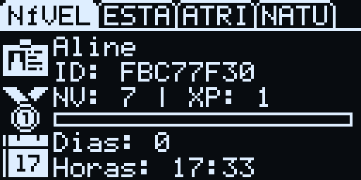 

### Inventário 

Sub-menu com as abas TODOS, COMIDAS, BEBIDAS e POCOES. Cada aba lista em ordem alfabética os itens possuídos do tipo (TODOS lista todos), com a quantidade à direita (`x12`). Itens com quantidade zero não aparecem; sem itens, a tela mostra "Nenhum item".

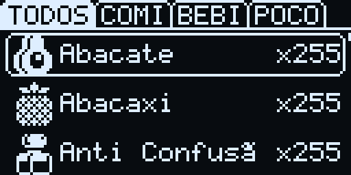

A abre um modal de escolha com:

- **Comer / Beber / Usar** (conforme o tipo): aplica o item e mostra a animação na tela principal. Se o Guará estiver desmaiado ou amaldiçoado, um alerta explica por que não dá para usar.
- **Detalhes:** descrição, efeitos (ex.: `Alimentação +15%`), curas e afinidade.
- **Descartar:** modal de quantidade e, depois, confirmação ("Descartar 3 Maçã?").
- **Compartilhar:** ainda não implementado (troca de itens entre Guarás, depende do Bluetooth); mostra um aviso.

O conteúdo do catálogo está em [CATALOG.md](CATALOG.md).

### Equipamentos 

Tela sem barra de título nem rodapé, com uma moldura de cantos arredondados em volta da tela inteira e uma divisória vertical. Do lado direito do aparelho (esquerda de quem olha) fica o manequim ; do outro lado, a lista dos 7 slots: Cabeça, Corpo, Mão ATK, Mão DEF, Calçados, Acessório 1 e Acessório 2. Cada linha mostra o nome do equipamento no slot ou "- Vazio -", centralizado, com *marquee* se não couber; a linha selecionada fica com fundo branco. A região do slot selecionado pisca no manequim duas vezes por segundo.

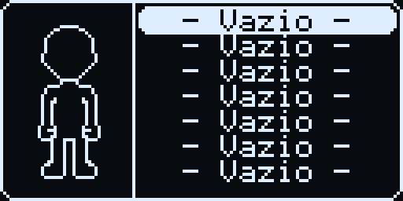

↑/↓ escolhem o slot. A, com o slot vazio, abre direto o sub-menu com os equipamentos possuídos daquele tipo; com o slot ocupado, abre um modal com Equipar e Remover. No sub-menu, os equipamentos já vestidos aparecem com `EQP`, e A equipa o item escolhido. Os dois slots de acessório aceitam qualquer acessório.

### Habilidades 

Sub-menu com as habilidades possuídas. As até 4 habilidades ativas, usadas no combate, aparecem com `ATV`. A mostra os detalhes da habilidade num modal (tipo, alvo, poder, custo de MP, natureza, efeitos e descrição), e ←/→ ativam ou desativam a habilidade selecionada. Com 4 ativas, um alerta avisa que não cabem mais.

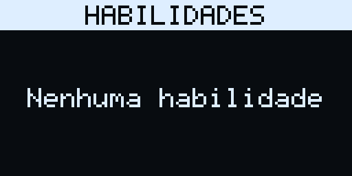

### Arena 

Sub-menu com duas opções:

- **Treino** : luta contra um Guará gerado com o mesmo nível e atributos de ±10%. Não abre se o Guará estiver desmaiado, dormindo ou com HP abaixo de 20%.
- **Combate** : combate contra outro Guará pela rede ou pelo Bluetooth. Ainda não implementado; mostra um aviso.

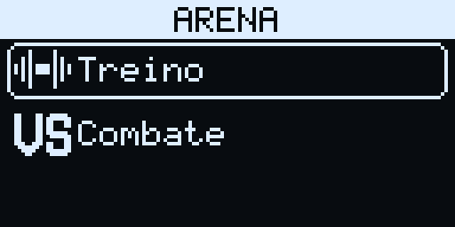

#### Tela de combate

Roda a 30 FPS e não deixa o aparelho entrar no modo Ocioso nem no deep sleep.

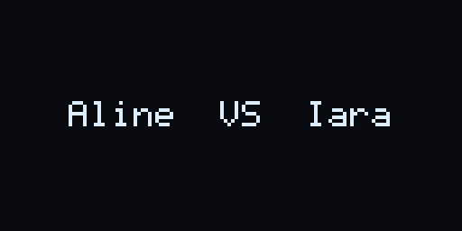 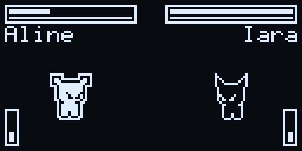

- **Abertura:** os nomes aparecem no formato "Fulano  VS  Siclano" por 1,8 s, ou em três linhas se não couberem; A ou B pulam a abertura.
- **Lutadores:** os dois Guarás em 1x, com a base em Y=50: o do jogador do lado esquerdo de quem olha (X=30) e o oponente do outro lado (X=98), espelhado, para os dois se olharem. A animação continua a 3 FPS, com o olhar de raiva.
- **Vitais:** no topo de cada lado, uma barra dupla de 56 x 8 px. O HP preenche a parte de cima (2 px de altura) e o MP é uma linha de 1 px embaixo, na mesma moldura. O nome do lutador fica logo abaixo. No oponente, o preenchimento e o nome partem da borda direita.
- **Barra de ação (ATB):** uma barra vertical de 6 x 16 px no canto inferior do lado de cada lutador. Enche de baixo para cima, no tempo dado pela AGI, e pisca quando cheia.
- **Escolha da ação:** A abre o modal de ações a qualquer momento, mesmo com a barra incompleta. Depois da escolha, ela não muda até o próximo ciclo (A não abre o modal), e a ação só é executada quando a barra enche. O tempo para enquanto o modal está aberto. Depois de cada golpe, A só volta a abrir o modal após 600 ms, para um toque atrasado da janela de reação não abrir o menu. As ações são:
	- **Atacar:** ataque físico.
	- **Habilidade:** escolha entre as habilidades ativas, com o custo de MP.
	- **Itens:** escolha entre os itens do tipo poção possuídos.
	- **Desistir:** confirmação; desistir vale na hora e encerra o combate como derrota.
	- B também oferece desistir.

	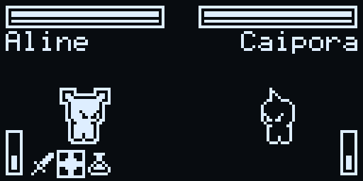

- **Janela de reação:** todo golpe contra o outro lado (ataque físico ou habilidade que não seja de cura) tem 600 ms de preparo. O atacante recua 3 px em 120 ms e segura; nos últimos 250 ms ele avança de volta até a posição original, e essa é a janela. Nada na tela indica a janela: o jogador prevê o tempo pelo movimento. Só vale uma tentativa por golpe, e apertar antes da janela perde a reação.
	- Se quem ataca apertar A na janela (**golpe certeiro**), a chance de crítico aumenta e o ataque físico pode sair duplo.
	- Se quem é atacado apertar A na janela (**defesa**), o dano cai e a chance de o atacante errar aumenta.
	- O oponente também reage, acertando a janela com uma chance fixa. Os valores estão em [docs/GAME_DESIGN.md](docs/GAME_DESIGN.md).
- **Animação do ataque:** o atacante dá um pulo de 6 px na direção do alvo e volta; no ataque duplo, pula duas vezes. O alvo atingido muda para o olhar atordoado, recua 2 px (1 px se defendeu) e pisca.
- **Impacto:** quando um golpe causa dano, os 7 quadros de `bitmaps/animations/hit` (16x16, a 30 FPS) aparecem na borda do sprite do alvo voltada para o atacante, à meia altura, desenhados em XOR: o preto é transparente e, onde a animação cruza o sprite, a cor se inverte. No ataque duplo, a animação se repete 8 px mais para dentro do sprite.
- **Mensagens:** o dano sobe a partir do alvo (`-10`), com `!` no crítico (`-10!`) e `2x` no ataque duplo (`2x-20`). Também aparecem "Esquivou!", "Errou!", "Falhou!" e as curas (`+30`). Itens e habilidades mostram o ícone no centro da tela, piscando cada vez mais rápido; numa cura, o alvo fica com o olhar feliz.
- **Fim do combate:** o vencedor fica com o olhar feliz e o perdedor com o olhar desmaiado, parado no quadro 1. Tocam a melodia de vitória ou de derrota, e a tela mostra "VITORIA!" ou "DERROTA". Depois de 2,5 s, A ou B continuam: na vitória aparece uma ficha com o XP ganho, o item obtido (se houver) e o novo nível; na derrota, a tela volta à Arena.
- **Consequências do treino:** o HP (mínimo de 1), o MP e os estados persistentes do combate voltam para o Guará, e cada luta custa 5% de energia. A vitória dá XP, pode dar um item e cura a maldição; os medidores ocultos também mudam (ver [docs/GAME_DESIGN.md](docs/GAME_DESIGN.md)).

#### Fórmulas do combate

1. **Tempo para encher a barra de ação:**
   $$\text{Tempo (s)} = \max\left(1{,}5;\ 6{,}0 - \text{AGI} \times 0{,}05\right)$$
   Com AGI 5, a barra leva 5,75 s; com AGI 90 ou mais, atinge o mínimo de 1,5 s.
2. **Dano físico:**
   $$\text{Dano} = \max\left(1;\ \lfloor \text{ATK} \times 1{,}2 + \text{FOR} \times 0{,}8 - \text{DEF} \times 0{,}7 \rfloor\right)$$
3. **Multiplicador elemental:** vantagem +25% e desvantagem −25% no dano das habilidades. Uma natureza composta neutraliza a fraqueza quando também contém o elemento atacante (ex.: Vapor contra Água recebe 1,0×).
4. **Crítico e esquiva:**
   $$\text{Crítico (\%)} = \min\left(50\%;\ 5\% + \text{SOR} \times 0{,}4\%\right),\quad \text{Dano crítico} = \lfloor \text{Dano} \times 1{,}5 \rfloor$$
   $$\text{Esquiva (\%)} = \min\left(35\%;\ (\text{AGI}_{\text{defensor}} - \text{AGI}_{\text{atacante}}) \times 0{,}3\%\right)\ \text{se}\ \text{AGI}_{\text{defensor}} > \text{AGI}_{\text{atacante}}$$

O dano de habilidade, o custo de MP, a cura, a ordem dos multiplicadores, os efeitos dos estados em combate, a IA do oponente e os valores da janela de reação estão em [docs/GAME_DESIGN.md](docs/GAME_DESIGN.md).

### Biblioteca 

Sub-menu com as obras da pasta `/sdcard/library`, montando o cartão se for preciso. Sem obras, mostra "Nada em /library".

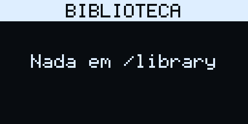

- **Texto simples** : arquivos `.txt`, com o nome do arquivo tratado como título (sem extensão e com `_` virando espaço).
- **Livro** : uma pasta com `book.ini`, `book.txt` e imagens. O título vem de `title=` na seção `[BOOK]` do `book.ini`, ou do nome da pasta. O texto pode citar imagens 1-bit de até 16x16 como `{{imagem.bmp}}`, que aparecem centralizadas numa linha própria.

O leitor quebra o texto em linhas de até 20 caracteres, preferindo os espaços, e aceita arquivos de até 64 KB. ↑/↓ rolam uma linha e ←/→ uma página; a barra de título some suavemente ao rolar para baixo. B fecha o leitor. Arquivos `.txt` abertos pelo Cartão SD usam o mesmo leitor.

### Jogos 

Sub-menu com os jogos do cartão, em ordem alfabética do nome da pasta, com o título do `game.ini` e o ícone de cada jogo, ou  sem ícone. A lista é lida da pasta a cada abertura.

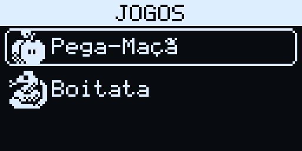

O console virtual executa jogos em Lua 5.4 a 30 FPS. Cada jogo é uma pasta em `/sdcard/games/<slug>/`; scripts `.lua` soltos em `/sdcard/games/` também aparecem, para testes rápidos.

```text
/sdcard/games/meu_jogo/
├── game.ini       # metadados e efeitos no Guará
├── main.lua       # lógica do jogo: init(), update(dt), draw()
├── icon.bmp       # ícone 16x16 da lista
├── load.bmp       # (opcional) tela de abertura
├── sprites.bmp    # (opcional) spritesheet
└── bgm.mid        # (opcional) música
```

**Ao abrir um jogo:**

1. O Wi-Fi é descarregado (`network_suspend`) para liberar memória.
2. A tela de abertura aparece por 1,5 s: o arquivo do campo `splash` (padrão `load.bmp`), centralizado; sem ele, o ícone ampliado 2x.
3. A VM Lua é criada em *sandbox*, com limite de 120 KB de memória e coletor de lixo incremental agressivo (pausa 100, multiplicador 250). Não há acesso a `io`, `os`, `require`, `dofile` nem `loadfile`.
4. O jogo roda o ciclo `init()` uma vez e, a cada quadro, `update(dt)` (com `dt` em segundos) e `draw()`.
5. O jogo termina ao chamar `exit()` ou ao segurar **B** por 2 s.

**O arquivo `game.ini`:**

```ini
[GAME]
title=Boitatá
icon=icon.bmp
splash=load.bmp

[GUARA_EFFECTS]
cost_energy_per_min=3
cost_food_per_min=2
gain_humor_per_min=4
gain_exp_per_min=5
gain_stat_focus=AGI
gain_stat_pts_per_min=1
affinity_elem=FIRE
affinity_pts_per_min=1
drop_item_id=14
drop_item_interval_min=2
```

- `[GAME]`: o firmware lê `title` (título na lista), `icon` e `splash`. Outros campos, como `author`, `version` e `description`, são só informativos.
- `[GUARA_EFFECTS]`: aplicado a cada minuto jogado. Gasta energia e alimentação (`cost_*`); dá humor, XP e pontos no atributo de `gain_stat_focus` (`ATK`, `DEF`, `STR`, `AGI`, `INT` ou `LUK`); soma afinidade no elemento de `affinity_elem` (`FIRE`, `EARTH`, `WATER`, `AIR`, `NEUTRAL`); e entrega o item `drop_item_id` a cada `drop_item_interval_min` minutos.

#### API Lua

Cores: `1` = branco, `0` = preto, `2` = inverter. As coordenadas podem ser fracionárias.

| Módulo | Funções |
|---|---|
| `oled` | `clear()`, `pixel(x,y[,c])`, `line(x0,y0,x1,y1[,c])`, `rect(x,y,l,a[,c])`, `fill(x,y,l,a[,c])`, `circle(x,y,r[,c])`, `fillcircle(x,y,r[,c])`, `text(x,y,s[,c])` → largura, `textwidth(s)`, `icon(nome,x,y[,opções])` (bitmap da VROM; opções = `espelhar` ou `{mode, scale, mirror}`), `icon_size(nome)` → largura, altura, `load(arquivo.bmp)` → id, `sprite(id,sx,sy,l,a,x,y[,espelhar])` (recorte de spritesheet) |
| `btn` | `up()`, `down()`, `left()`, `right()`, `a()`, `b()` (segurando), `pressed(nome)` (só no quadro em que desceu) |
| `audio` | `beep(freq,ms)`, `note(nota_midi,ms)`, `play_midi(arquivo)` (da pasta do jogo), `stop()` |
| `guara` / `pet` | `get_status()`, `give_item(id\|slug,qtd)`, `add_stat(nome,valor)`, `add_exp(pontos)`, `add_affinity(elemento,pontos)`, `report_result(vitoria)`, `draw(x,y[,{eye, scale, mirror, frame}])` → altura (desenha o Guará do jogador com a base em `y`, centralizado em `x`) |
| `catalog` | `item(id\|slug)`, `equipment(id\|slug)`, `skill(id\|slug)` → `{id, slug, name, icon, type, description}` (itens também têm `owned`), `count("items"\|"equipment"\|"skills")` |
| `ui` (desenho) | `title(texto)`, `tabs({nomes}, sel)`, `list({itens}, sel[,{id, y, rows}])` (itens = texto ou `{text, icon, info}`), `footer(texto_b, texto_a)`, `progress(x,y,l,a,valor,max)`, `scrollbar(y,a,total,visiveis,topo)`, `marquee(x,y,l,texto[,{id, color}])`, `paragraph(x,y,l,max_linhas,texto[,centralizar])`, `text_center(x,l,y,texto[,c])` |
| `ui` (interativos) | `alert(titulo,msg[,icone[,ao_fechar]])`, `confirm(titulo,msg,ao_responder(sim)[,texto_nao,texto_sim])`, `choice(titulo,{opcoes},ao_escolher(i))` (até 16 opções), `quantity(titulo,min,max,inicial,ao_escolher(n))`, `details(titulo,texto)`, `keyboard(titulo,inicial,max,ao_concluir(texto))` |
| `storage` | `save(chave,texto)`, `load(chave)`: arquivos isolados na pasta do jogo, com chave de letras, números e `_` |
| globais | `exit()`, `millis()`, `WIDTH` (128), `HEIGHT` (64) |

- **`guara.get_status()`:** devolve `name`, `nature`, `level`, `xp`, `hp`, `hp_max`, `mp`, `mp_max`, `energy`, `mood`, `satiety`, `health`, `atk`, `def`, `str`, `agi`, `int`, `luk` e a aparência: `color` (`black`/`white`), `head` (1..9) e `stage` (0..4).
- **`guara.add_stat(nome, valor)`:** aceita os mesmos nomes de vitais e atributos.
- **`guara.add_affinity(elemento, pontos)`:** `fire`, `earth`, `water`, `air` e `neutral` seguem as regras de *Afinidades*; `light` e `shadow` movem o medidor Dia × Noite; `mind` soma pontos de INT.
- **`guara.report_result(vitoria)`:** registra o resultado (`true` = vitória) no medidor Vitórias × Derrotas.
- **Índices:** `sel`, `topo` e as respostas de `ui.choice` começam em 1, como é comum no Lua.
- **Modos de desenho (`mode`):** `or` (padrão: só os pixels brancos aparecem), `copy` (opaco), `mask` (o preto apaga e o branco é transparente), `xor` (inverte o fundo) e `invert` (opaco com as cores trocadas). `scale = 2` amplia 2x.
- **Olhos do `guara.draw`:** `standard`, `happy`, `anger`, `bored`, `closed`, `dazed`, `fainted`, `scared` e `wink`.
- **Componentes de desenho:** só desenham. O jogo guarda a seleção e chama o componente no `draw()` a cada quadro. Listas e letreiros têm até 4 estados independentes, escolhidos pelo `id` (1..4).
- **Componentes interativos:** abrem a tela do sistema por cima do jogo, que fica em pausa (o `update()` não roda e o `draw()` continua desenhando o último estado). A resposta chega pela função de retorno, e B sempre cancela: `nil` na escolha, na quantidade e no teclado, `false` na confirmação. A tecla que fecha o modal não é repassada ao jogo.

Há exemplos completos em `examples/sdcard/games/`; copie a pasta do jogo para `/games` no cartão:

- `apple_catch/`: Pega-Maçã, exemplo curto e comentado da API.
- `boitata/`: Boitatá, jogo da serpente de fogo com menu, configurações, slots de save e ranking. É o jogo de referência do projeto e evolui junto com o console.

### Músicas 

Sub-menu com os arquivos `.mid` e `.midi` de `/sdcard/music`, com o nome tratado (sem extensão e com `_` virando espaço). A abre o tocador.

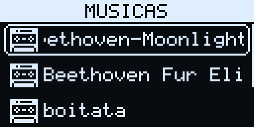

- **Som:** o MIDI é reduzido a uma voz (vale a nota mais aguda ativa) e tocado em onda quadrada pelo LEDC, numa task de áudio em segundo plano. Os efeitos sonoros interrompem a música enquanto tocam.
- **Tocador:** título com o nome da faixa (com *marquee*), ícone de tocar ou pausar, barra de progresso, tempo atual e total em `mm:ss` e o nível de volume.
- **Controles:** A toca e pausa, ↑/↓ trocam de faixa, ←/→ ajustam o volume (1 a 3) e B volta à lista sem parar a música.
- Tocar uma música cura a maldição do Guará.

### Imagens 

Sub-menu com os `.bmp` de `/sdcard/image` e o tamanho de cada arquivo. A abre um modal com **Abrir**, **Detalhes** e **Excluir** (com confirmação). O visualizador mostra a imagem 1-bit; se ela for maior que a tela, os direcionais a deslocam de 8 em 8 px, e A ou B fecham.

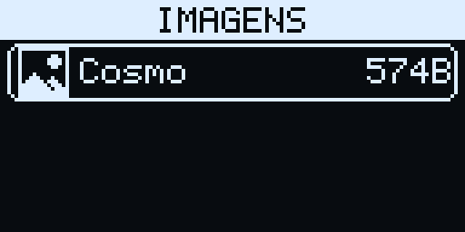

> TODO: criar imagens de 64x64, 32x32 ou 16x16 no aparelho.

### Relógio 

Sub-menu com Despertador, Cronômetro, Temporizador, Hora de dormir e Configurar.

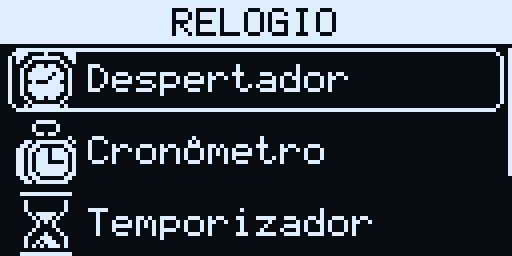

- **Editor de hora:** tela padrão usada pelos despertadores, pelo temporizador, pela hora de dormir e pelo ajuste manual. Mostra `HH:MM` centralizado numa fonte maior e o rodapé CANCELAR (B) / SALVAR (A). ←/→ movem o cursor e ↑/↓ mudam o dígito. O cursor é um retângulo de cantos arredondados preenchido, que pisca invertendo a cor do dígito. Nas horas, o primeiro dígito vai de 0 a 2 e o segundo de 0 a 9 (até 23); nos minutos, o primeiro vai de 0 a 5 e o segundo de 0 a 9.

	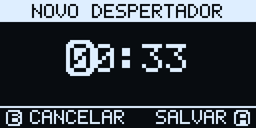

- **Despertador** : lista com **Criar**  e os despertadores salvos (até 8), gravados em `/sdcard/guara/alarms.txt`. Criar abre o editor; num despertador salvo, o editor edita a hora, e cancelar pergunta se o despertador deve ser apagado. Os despertadores tocam em segundo plano, mesmo com o aparelho em deep sleep: uma sequência de bipes e um alerta com a hora. Confirmar o alerta para os bipes; sem confirmação, eles param sozinhos em 1 minuto.

	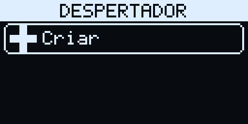

- **Cronômetro** : o tempo `MM:SS.d` em fonte maior e o rodapé SAIR (B) / INICIAR ou PARAR (A).
- **Temporizador** : o tempo em fonte maior e o rodapé SAIR (B) / INICIAR ou PARAR (A). Parado, o tempo pode ser editado. Ele conta em segundo plano e sobrevive ao deep sleep (fica na RTC RAM, e o aparelho acorda no fim). No fim, toca e mostra o alerta "A contagem terminou!", com as mesmas regras do despertador.

	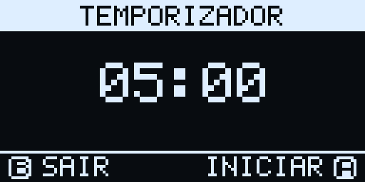

- **Hora de dormir** : sub-menu com **Dormir** e **Acordar**, mostrando os horários à direita (padrão 20:00 e 08:00). O Guará dorme no minuto da hora de dormir e acorda na hora de acordar, se a energia passar de 50% (ver *Ciclo de vida*).

	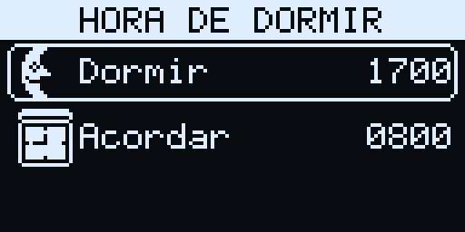

- **Configurar** : **Ajuste manual** , com o editor de hora, e **Sincronizar NTP** , que acerta a hora pela internet.

### Cartão SD 

Gerenciador de arquivos do cartão no padrão de sub-menu, começando em `/sdcard`. A barra de título mostra a pasta atual e a informação à direita é o tamanho (`574B`, `12K`, `3M`) ou `DIR`. A abre a pasta ou o modal de comandos do arquivo; ←/→ abrem os comandos também para pastas; B sobe um nível e, na raiz, volta ao menu.

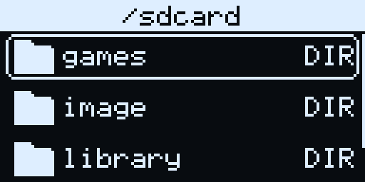 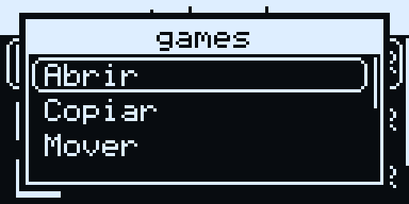

- **Ícones:**
	- pasta ;
	- imagem `.bmp` ;
	- música `.mid` / `.midi` ;
	- script `.lua` ;
	- dados `.sav`, `.dat`, `.idx` ;
	- texto `.txt` ;
	- configuração `.ini`, `.cfg` ;
	- outros .
- **Comandos:**
	- **Abrir:** imagens `.bmp` aparecem na tela, `.txt` abre no leitor da Biblioteca e `.lua` roda no console virtual; outros tipos mostram "Tipo de arquivo não suportado".
	- **Copiar / Mover:** marca o arquivo; navegando até outra pasta, a primeira linha da lista vira "Colar aqui" ou "Mover aqui".
	- **Renomear:** abre o teclado virtual com o nome atual.
	- **Excluir:** pede duas confirmações; pastas são apagadas com o conteúdo.
	- **Detalhes:** nome completo, tipo e tamanho em bytes.

### Ajustes 

Sub-menu com o estado de cada opção à direita.


1. **Wi-Fi**  (`ON` / `OFF`): rede permitida ou proibida (ver *Wi-Fi sob demanda*).
	1. **Liga/Desliga**  (`ON` / `OFF`).
	2. **Status** : estado da rede, roteador, IP, sinal em dBm e a última sincronização NTP.
	3. **Buscar** : lista as redes com o sinal; escolher uma pede a senha no teclado virtual e conecta.
	4. **Redes salvas** : conectar ou esquecer cada rede.

	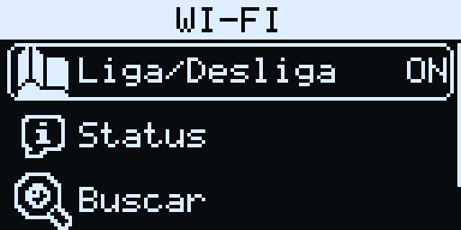

2. **Bluetooth**  (`ON` / `OFF`): Liga/Desliga, Buscar e Dispositivos pareados. Ainda não implementado; as opções mostram um aviso.
3. **Energia**  (`###%` / `USB`):
	1. **Status** : porcentagem, tensão e se está carregando.
	2. **Economia** : tempo sem uso até o deep sleep: 1, 2, 5 ou 10 minutos, ou Desativado (`OFF`).

	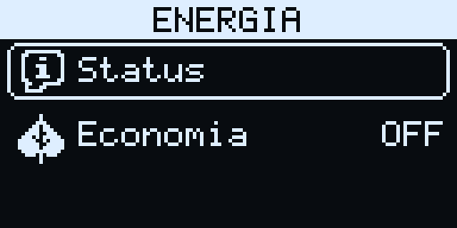 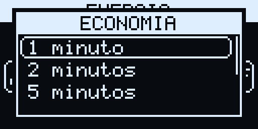

4. **Armazenamento**  (`OK` / `--`):
	1. **Memória interna** : bitmaps da VROM, registros do catálogo, saves gravados e memória livre.
	2. **Micro SD** : capacidade e espaço livre do cartão.
5. **Controle** : teste dos botões, que acendem na tela enquanto pressionados. Segure B por 1 s para sair.
6. **Som**  (`MUDO` / vazio):
	1. **Mudo** : liga ou desliga o som. Os alarmes tocam mesmo no mudo.
	2. **Teste de som** : toca uma escala no buzzer.
7. **Sistema** :
	1. **Status** : versão do firmware, data da compilação, versão do ESP-IDF, memória livre e maior bloco livre.
	2. **Atualizar** :
		1. **GitHub** : ainda não implementado; mostra um aviso.
		2. **Micro SD** : com confirmação, grava `/sdcard/update/firmware.bin` na partição OTA livre e/ou `/sdcard/update/storage.bin` na partição `storage`, e reinicia.
8. **Reiniciar** : apaga o Guará e começa de novo (*Factory Rebirth*). Pede duas confirmações ("Apagar o Guará e começar de novo?" e "Perda irreversível! Tem certeza?"). Ao confirmar, o anel de saves é apagado e começa o nascimento de um novo Guará.

___

## Regras do jogo

Os valores numéricos das regras abaixo estão em `lib/core/src/rules.h` e documentados em [docs/GAME_DESIGN.md](docs/GAME_DESIGN.md). O ciclo de vida avança um passo por minuto real (`guara_tick_minute`).

### Pontos

#### Nível

- **Nível (NV):** de 1 a 99; define o estágio de evolução.
- **Experiência (XP):** obtida em combates na arena e em minijogos. Ao atingir o XP do próximo nível, o Guará sobe de nível e ganha atributos.
- **Idade:** tempo de vida em dias e horas. Guarás mais novos ganham XP mais rápido.

#### Vitais

- **HP:** pontos de vida. Em zero, o Guará desmaia.
- **MP:** pontos de magia, gastos pelas habilidades.
- **Energia:** de 0 a 100%; recupera dormindo.
- **Humor:** de 0 a 100%; quando baixo, define a emoção.
- **Alimentação:** de 0 a 100%; com 10% ou menos, o Guará fica faminto.
- **Saúde:** de 0 a 100%; ajusta o ritmo de todo o desgaste (saúde alta desgasta mais devagar).

#### Atributos

- **Ataque (ATK)** e **Força (FOR):** aumentam o dano.
- **Defesa (DEF):** diminui o dano recebido.
- **Agilidade (AGI):** acelera a barra de ação e dá chance de esquiva.
- **Inteligência (INT):** aumenta o dano e a cura das habilidades, diminui o custo de MP e pode levar à natureza Psíquica.
- **Sorte (SOR):** aumenta a chance de crítico e de ganhar itens.

#### Afinidades

As afinidades definem a evolução da natureza. São medidas em % para Fogo, Terra, Água, Ar e Neutra e vêm de comidas, bebidas, combates, minijogos e livros.

- Ganhar afinidade num elemento tira a mesma quantidade do elemento oposto: Fogo × Água e Terra × Ar.
- O elemento Neutro ganha pontos de forma direta (item, livro ou jogo) ou indireta: os pontos da natureza de nascimento do Guará vão para o Neutro.
- O sistema de afinidades desliga quando o Guará adquire uma natureza secundária.

#### Medidores ocultos

| Medidor | O que move o medidor | Efeito |
|---|---|---|
| **Vitórias × Derrotas** | Resultados de combates e minijogos. | Tende para um dos lados conforme os resultados. |
| **Cuidado × Negligência** | Tempo em que o Guará fica bem cuidado ou abandonado; desmaios e refeições. | Registra o histórico de cuidado. |
| **Tristeza × Raiva** | O descaso move para **Raiva**; as derrotas movem para **Tristeza**. | Com o Humor baixo, define a emoção: equilibrado → **Entediado**; tendendo a um lado → **Triste** ou **Zangado**. |
| **Dia × Noite** | Interações nas 2 h depois da hora de acordar tendem para **Dia**; nas 2 h antes da hora de dormir, para **Noite**; nos outros horários o medidor volta ao equilíbrio. | Um desequilíbrio alto funciona como as afinidades **Luz** e **Sombra** na evolução. |

### Naturezas

As naturezas definem vantagens e desvantagens, habilidades e equipamentos:

| Natureza | Ícone | Composição |
|---|---|---|
| Fogo |  | primária |
| Terra |  | primária |
| Água |  | primária |
| Ar |  | primária |
| Neutra |  | — |
| Eletricidade |  | Fogo + Ar |
| Planta |  | Terra + Água |
| Gelo |  | Ar + Água |
| Vapor |  | Fogo + Água |
| Cristal |  | Terra + Ar |
| Lava |  | Fogo + Terra |
| Sombra |  | especial |
| Luz |  | especial |
| Psíquica |  | especial |

As vantagens seguem o ciclo dos elementos primários, Fogo < Água < Terra < Ar < Fogo (cada um perde para o seguinte), e são herdadas pelas naturezas compostas. Uma natureza composta neutraliza a fraqueza que teria contra um elemento que ela também contém. Exemplo: um Guará de Vapor (Fogo + Água) teria fraqueza contra Água pelo lado Fogo, mas como também é Água, a fraqueza some. Luz e Sombra têm vantagem uma contra a outra; Neutra e Psíquica são neutras contra tudo.

### Evolução

O Guará passa por 5 estágios: bebê, jovem A, jovem B, jovem C e adulto, nos níveis definidos em [docs/GAME_DESIGN.md](docs/GAME_DESIGN.md). Ao entrar nos estágios jovem B, jovem C e adulto, a natureza pode evoluir.

O Guará nasce com uma natureza primária. Conforme as afinidades, os medidores e os atributos, pode adquirir uma natureza secundária:

- **Fusão:** se a maior afinidade for um elemento diferente do de nascimento, a natureza vira a fusão dos dois:
	- Fogo + Terra = **Lava**;
	- Fogo + Ar = **Eletricidade**;
	- Fogo + Água = **Vapor**;
	- Terra + Ar = **Cristal**;
	- Terra + Água = **Planta**;
	- Ar + Água = **Gelo**.
- **Maior afinidade Neutra:**
	- **Luz:** grande desequilíbrio do medidor Dia × Noite para **Dia**;
	- **Sombra:** grande desequilíbrio para **Noite**;
	- **Psíquica:** INT muito acima de todos os outros atributos;
	- **Neutra:** nenhum dos casos acima, já no estágio adulto.

As naturezas não se acumulam: a natureza secundária é definitiva e desliga o sistema de afinidades. Enquanto o Guará mantém a natureza primária, as afinidades continuam ativas para tentar evoluir no próximo estágio.

### Ciclo de vida

#### Desgaste

A cada minuto, energia e alimentação diminuem (a alimentação cai pela metade dormindo, e a energia recupera dormindo). A partir delas:

- Com energia ou alimentação **abaixo de 50%**, o humor começa a cair.
- Com energia ou alimentação **abaixo de 20%**, a saúde começa a cair.
- Com alimentação **em 10% ou menos**, o Guará fica **Faminto** e perde HP. Com HP 0, ele desmaia.
- A **saúde sobe** quando alimentação, energia e humor estão acima de 50%.
- O **humor sobe** quando energia e alimentação estão acima de 40%. Os minijogos também dão humor, e muito tempo sem interação faz o humor cair.
- **Recuperação de HP:** quando alimentação, saúde e energia passam de 50%, o HP começa a subir queimando energia, e continua até a energia chegar a 10%. A energia só é gasta enquanto o HP não está cheio, e a recuperação fica em pausa enquanto o Guará dorme.
- **Sono:** com energia abaixo de 20% (acordado), o Guará fica **Cansado**. A noite vai da hora de dormir até a hora de acordar (Relógio > Hora de dormir). Sem fome, ele **dorme** com energia 0, na hora de dormir ou, à noite, depois de alguns minutos sem interação. Dormindo, a energia volta a subir. À noite ele continua dormindo mesmo com a energia cheia; acorda de manhã, depois da hora de acordar, se a energia passar de 50%, ou se ficar com fome. De dia, um cochilo termina com a energia cheia. Comer acorda o Guará, mas à noite ele volta a dormir quando fica sem interação.
- O descaso aumenta a **Negligência**; o tempo com tudo acima de 50% aumenta o **Cuidado**.

#### Estados

Os estados são físicos ou emocionais e podem trazer desvantagens e restrições. Os ícones aparecem no balão da tela principal.

**Estados físicos**, causados pelo desgaste ou pelo combate:

| Estado | Ícone | Efeito |
|---|---|---|
| Normal | — | Estado padrão; o balão não aparece. |
| Dormindo |  | Recupera energia. |
| Desmaiado |  | Com HP 0. Bloqueia tudo por 10 min; depois aceita itens que curam HP. Desmaiar cura veneno, queimadura, gelo, paralisia, confusão e maldição. |
| Envenenado |  | Perde 2% do HP máximo e 1% de saúde por minuto (5% do HP por turno em combate). |
| Paralisado |  | Perde a vez no combate. |
| Queimado |  | Como o veneno. |
| Congelado |  | Como o veneno, e perde a vez no combate. |
| Confuso |  | 50% de chance de errar o golpe; ao errar, 50% de atingir a si mesmo. |
| Amaldiçoado |  | Não usa itens nem habilidades. Cura com a vitória, ao desmaiar ou ao ouvir uma música. |
| Cansado |  | Atributos 30% menores. |
| Faminto |  | Perde 1% do HP máximo por minuto. |

**Estados emocionais**, influenciados pelo cuidado e pelas atividades. Só um vale por vez:

| Estado | Ícone | Quando | Efeito |
|---|---|---|---|
| Feliz |  | Os 4 vitais acima de 80%. | A saúde se recupera 20% mais rápido. |
| Triste |  | Humor baixo e medidor tendendo a Tristeza. | O desgaste fica 20% mais rápido. |
| Zangado |  | Humor baixo e medidor tendendo a Raiva. | ATK +50% e DEF −50%. |
| Entediado |  | Humor baixo com o medidor equilibrado, ou 2 h sem interação. | O desgaste fica 5% mais rápido. |

As emoções negativas aparecem no balão de 5 a 30 s a cada 20 a 30 minutos. O Feliz aparece junto com o olhar feliz, de 5 a 10 s a cada 20 a 30 minutos.

___

## Sprites

O Guará é composto de três partes, desenhadas em modo opaco (`copy`): corpo, cabeça e olhos. Cada parte existe na versão preta e na branca. Os nomes seguem padrões fixos, porque o código monta o nome de cada bitmap:

- `sprite_<estágio>_<cor>_<quadro>` (corpo), com estágio `baby`, `yong_a`, `yong_b`, `yong_c` ou `adult_a`, cor `black` ou `white` e quadro `1` ou `2`;
- `sprite_head_<cor>_variant_<1..9>` (cabeça);
- `sprite_eye_<cor>_<olho>` (olhos).

**Cabeças:** sorteadas no nascimento entre 9 variantes, ficam na parte de cima do sprite e se mantêm em todas as evoluções.

| Variante | Preta | Branca |
|---|---|---|
| 1 |  |  |
| 2 |  |  |
| 3 |  |  |
| 4 |  |  |
| 5 |  |  |
| 6 |  |  |
| 7 |  |  |
| 8 |  |  |
| 9 |  |  |

**Corpos:** variam só com a cor e o estágio. A animação tem 3 quadros a 3 FPS, na sequência dos bitmaps 1, 2, 2. O corpo do quadro 2 é 1 px mais alto.

| Estágio | Preto | Branco |
|---|---|---|
| Bebê (`baby`) |   |   |
| Jovem A (`yong_a`) |   |   |
| Jovem B (`yong_b`) |   |   |
| Jovem C (`yong_c`) |   |   |
| Adulto (`adult_a`) |   |   |

**Composição:** o corpo e a cabeça ficam centralizados no X indicado, com a base do corpo no Y indicado e a cabeça encaixada em cima. Os olhos ficam centralizados sobre o corpo, 1 px abaixo do topo do corpo do quadro 1, nos quadros 1 e 2, e sobem 1 px no quadro 3. Com ampliação 2x, todas as partes são ampliadas mantendo o encaixe.

**Olhos:** mudam conforme o estado e a emoção, na prioridade definida em [docs/GAME_DESIGN.md](docs/GAME_DESIGN.md).

| Olho | Preto | Branco | Uso |
|---|---|---|---|
| Normal (`standard`) |  |  | Sem nenhum estado específico. |
| Raiva (`anger`) |  |  | Zangado e durante o combate. |
| Entediado (`bored`) |  |  | Triste ou entediado. |
| Fechado (`closed`) |  |  | Dormindo; piscada a cada 3 a 6 s. |
| Atordoado (`dazed`) |  |  | Fome, cansaço, confusão, paralisia e golpe recebido. |
| Desmaiado (`fainted`) |  |  | Desmaiado e derrota. |
| Feliz (`happy`) |  |  | Vitória, cura, cada mordida e 5 a 10 s a cada 20 a 30 min com o estado Feliz. |
| Assustado (`scared`) |  |  | Veneno, queimadura ou gelo. |
| Piscadela (`wink`) |  |  | Logo depois de comer ou usar um item. |

**Outras animações:** `bite_1` a `bite_5` (mordidas da comida) e `hit_1` a `hit_7` (impacto no combate), em `bitmaps/animations/`.

___

## Implementação

### Versionamento

A versão segue o formato `v#.#.#` (lançamento.funcionalidade.correção) e só muda com alterações no firmware ou no storage. Mudanças só na documentação geram apenas um commit.

Cada escopo executado gera um commit e uma entrada no [CHANGELOG.md](CHANGELOG.md).

### Código

Por ser um projeto de aprendizado, o código segue estas regras:

- Identificadores, funções, arquivos e pastas são descritivos e em **inglês**.
- Os comentários são em **português** e abundantes: um comentário de cabeçalho em cada arquivo e um antes de cada função.
- Os textos mostrados no aparelho são em português.
- O código segue as boas práticas de arquitetura e desenvolvimento do mercado.
- O catálogo contém só o que o autor definiu em [CATALOG.md](CATALOG.md); campos ausentes ficam com o valor neutro e são apontados ao autor.

___

## Licença

- **Código:** o firmware, as bibliotecas em `lib/` (menos `lib/lua`), as ferramentas em `tools/`, os jogos de exemplo e a documentação estão sob a licença do arquivo [LICENSE](LICENSE).
- **Lua:** `lib/lua` é o Lua 5.4.7 original, sob a licença MIT da PUC-Rio, com o aviso de copyright no próprio código (`lua.h`).
- **Artes (`bitmaps/`):** só as artes de autoria do projeto estão cobertas pela licença do repositório. Parte das artes atuais tem **origem desconhecida** e **não** está licenciada; elas são usadas provisoriamente durante o desenvolvimento e serão substituídas antes da versão 1.0.0. A origem de cada bitmap está em [bitmaps/ASSETS.md](bitmaps/ASSETS.md). Se você é o autor de alguma dessas artes e quer crédito ou a remoção, abra uma *issue*.
