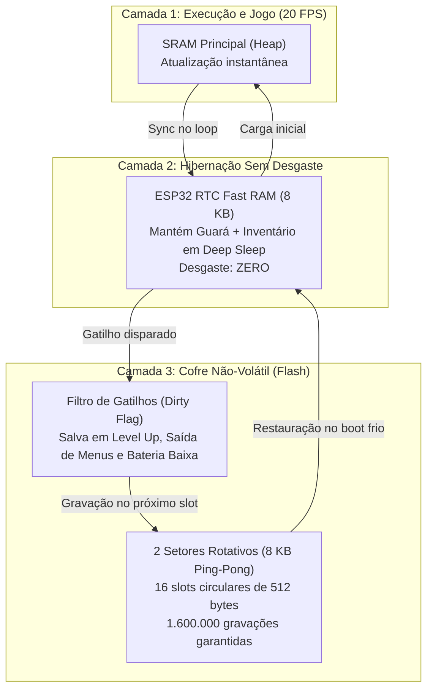
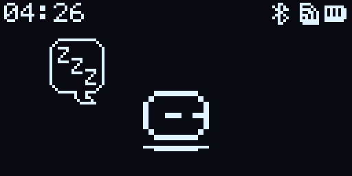
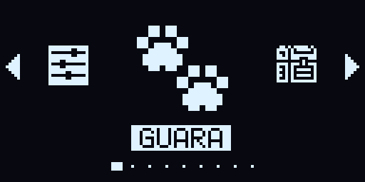
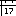
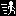
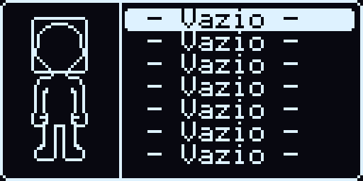
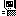

# Guará

## Descrição do Projeto

O projeto conciste em um eco sistema para criaturas virtuais chamadas Guarás. O Guará é um pet virtual que deve ser alimentado, cuidado e vestido pelo usuário, ele possui a capacidade de evoluir por diferentes linhas evolutivas dependendo do modo como é criado. Um Gurá pode se conectar com outro para realizar atividades como, troca de itens, jogos multiplayer, cooperativo e competitivo, e batalhas nos moldes de RPGs.

___

## Hardware

### Componentes

1. **CPU** - ESP32 WROOM 32 (Node MCU ESP32).
2. **Vídeo** - Modulo Display OLED monocromatico SPI ou I2C com resolução de 128x64px 1.3" ( SH1106 1.3" I2C ou OLED 1.3" SPI ).
3. **Áudio** - Buzer piezoelétrico (Buzer Genérico + BC337 + Res 1 K).
4. **Armazenamento** - Além da memoria flash interna do ESP32, será utilizado um modulo Micro SD (Micro SD SPI TF).
5. **Alimentação** - O dispositivo será alimentado por uma bateria de LiPo de 3.7V 1200mAh, com modulo de controle de carga e descarga e um modulo step-down para 3.3v (TP4056 + S09 DC-DC). O step-down S09 fornece até 1100 mA, bem acima do consumo medido do sistema (ver *Gerenciamento de Energia e Bateria*).
6. **Controles** - Serão utilizados 6 botoes ligados as portas com pull-up interno do ESP32, Cima, Baixo, Esquerda, Direita, A (Confirmar) e B (Voltar/Cancelar) (Chaves Tates ).
7. **Conectividade** - O dispositivo possui conexão Wifi e Bluetooth já presentes no modulo da CPU (Node MCU ESP32). 
8. **Relógio (RTC)** - Módulo RTC DS3231 (I2C, endereço 0x68) com bateria própria (CR2032), compartilhando o barramento I2C do display. É a fonte de hora do sistema: mantém a hora com precisão em Deep Sleep e mesmo com a bateria LiPo descarregada. O RTC interno do ESP32 não é usado como referência de tempo, pois os pinos do cristal de 32 kHz (GPIO32/33) estão ocupados pelos botões e o oscilador RC interno deriva vários minutos por hora.

### Esquema

| #   | Portas do Node MCU                   | Conexão                       | Modulo             | Descrição                                                                          |
| --- | ------------------------------------ | ----------------------------- | ------------------ | ---------------------------------------------------------------------------------- |
| 1   | 3V3                                  | OUT+                          | S09 DC-DC          | Alimentação positiva de 3.3V regulada do sistema                                   |
| 2   | GND                                  | GND (0V)                      | Todos              | Referência comum de terra (Ground)                                                 |
| 3   | GPIO15 / ADC2_3 / Touch3 / HSPI_CS   | NC                            |                    |                                                                                    |
| 4   | GPIO2 / ADC2_2 / Touch2 / CS         | NC                            |                    |                                                                                    |
| 5   | GPIO4 / ADC2_0 / Touch0              | NC                            |                    |                                                                                    |
| 6   | GPIO16 / U2_RXD                      | NC                            |                    |                                                                                    |
| 7   | GPIO17 / U2_TXD                      | NC                            |                    |                                                                                    |
| 8   | GPIO5 / VSPI_CS                      | CS                            | Micro SD SPI TF    | Chip Select (SS) do barramento SPI para o MicroSD                                  |
| 9   | GPIO18 / SCK / VSPI_CLK              | SCK / CLK                     | Micro SD SPI TF    | Clock do barramento SPI (VSPI)                                                     |
| 10  | GPIO19 / MISO / VSPI_MISO            | MISO / DO                     | Micro SD SPI TF    | Master In Slave Out (dados do MicroSD para o ESP32)                                |
| 11  | GPIO21 / SDA                         | SDA                           | SH1106 1.3" I2C / DS3231 | Linha de dados seriais do barramento I2C (compartilhado entre display e RTC) |
| 12  | GPIO3 / U0_RXD / CLK2                | RX (USB-Serial CP2102)        | CPU / Gravação USB | UART0 RX: recepção serial, upload de firmware e logs                               |
| 13  | GPIO1 / U0_TXD / CLK3                | TX (USB-Serial CP2102)        | CPU / Gravação USB | UART0 TX: transmissão serial para log de console                                   |
| 14  | GPIO22 / SCL                         | SCL                           | SH1106 1.3" I2C / DS3231 | Linha de clock serial do barramento I2C (400 kHz, compartilhado entre display e RTC) |
| 15  | GPIO23 / MOSI / VSPI_MOSI            | MOSI / DI                     | Micro SD SPI TF    | Master Out Slave In (dados do ESP32 para o MicroSD)                                |
| 16  | EN                                   | NC                            |                    |                                                                                    |
| 17  | GPIO36 / ADC1_0 / SensVP             | NC                            |                    |                                                                                    |
| 18  | GPIO39 / ADC1_3 / SensVN             | NC                            |                    |                                                                                    |
| 19  | GPIO34 / ADC1_6                      | Divisor 100kΩ / 100kΩ         | Monitor de Bateria | Entrada ADC1_CH6 para leitura de tensão da bateria LiPo (funciona com Wi-Fi ativo) |
| 20  | GPIO35 / ADC1_7                      | CHRG (pull-up externo 100kΩ)  | TP4056             | Detecção de carga: nível baixo enquanto a bateria carrega pelo USB (GPIO35 é só entrada e não tem pull-up interno) |
| 21  | GPIO32 / ADC1_4 / Touch9 / XTAL32    | Botão Cima (Pull-up int.)     | Controles          | Direcional Cima (conecta ao GND; pino RTC para Deep Sleep Wake-up)                 |
| 22  | GPIO33 / ADC1_5 / Touch8 / XTAL32    | Botão Baixo (Pull-up int.)    | Controles          | Direcional Baixo (conecta ao GND; pino RTC para Deep Sleep Wake-up)                |
| 23  | GPIO25 / ADC2_8 / DAC1               | Buzzer / Transistor           | Áudio (Buzzer)     | Saída de áudio PWM (LEDC canal 0) para buzzer piezoelétrico                        |
| 24  | GPIO26 / ADC2_9 / DAC2               | Botão B (Pull-up int.)        | Controles          | Botão B / Cancelar / Voltar (conecta ao GND ao pressionar)                         |
| 25  | GPIO27 / ADC2_7 / Touch7             | Botão Direita (Pull-up int.)  | Controles          | Direcional Direita (conecta ao GND ao pressionar)                                  |
| 26  | GPIO14 / ADC2_6 / Touch6 / HSPI_CLK  | Botão Esquerda (Pull-up int.) | Controles          | Direcional Esquerda (conecta ao GND ao pressionar)                                 |
| 27  | GPIO12 / ADC2_5 / Touch5 / HSPI_MISO | Livre / NC                    | ESP32              | Strapping MTDI (deve estar LOW no boot para Flash 3.3V)                            |
| 28  | GPIO13 / ADC2_4 / Touch4 / HSPI_MOSI | Botão A (Pull-up int.)        | Controles          | Botão A / Confirmar / Ação (conecta ao GND ao pressionar)                          |
| 29  | GND                                  | GND (0V)                      | Todos              | Referência comum de terra (Ground)                                                 |
| 30  | VIN                                  | IN+                           | TP4056 / USB       | Entrada de alimentação 5V (USB ou saída do módulo de bateria)                      |

### Montagem

Como o pino VIN do Node MCU sera ligado no modulo de recarga de bateria e o pino 3.3V na saída do modulo step-down, o regulador de tensão do Node MCU é removido, juntamente com o LED indicado de alimentação, o mesmo se aplica ao modulo Micro SD, caso ele possua um regulador integrado. Também sera removido os LEDs indicadores de todos o módulos que o possuam, com exceção o indicado de regarga.

A montagem dos protótipo sere feito em uma estrutura modelada e impressa em 3D, com os módulos inteigados por cabo paralelos estilo IDE,  posteriormente sera desenvolvida uma PCB que comporte todos os modulos.

O protótipo usado nos testes utiliza um display OLED SH1106 1.3" I2C (GPIO 21 SDA / GPIO 22 SCL) e o RTC DS3231 no mesmo barramento I2C. O pino CHRG do TP4056 (saída open-drain) é ligado ao GPIO 35 com resistor de pull-up externo de 100 kΩ para o 3.3V. O suporte a displays OLED SPI (compartilhando barramento VSPI) e circuitos dedicados de medição avançada de bateria serão implementados em revisões futuras de hardware e mantidos em branches dedicadas.

### Gerenciamento de Energia e Bateria

O sistema possui um subsistema dedicado de gerenciamento de energia para maximizar a autonomia da bateria LiPo de 3.7V 1200mAh:
- **Detecção de Carga:** O pino CHRG do TP4056 no GPIO 35 indica quando a bateria está sendo carregada pelo USB (nível baixo). Com a carga completa, o CHRG volta ao nível alto, então nesse estado o sistema exibe apenas a porcentagem da bateria.
- **Monitoramento Analógico:** Utiliza um divisor de tensão resistivo (100 kΩ / 100 kΩ) conectado ao pino GPIO 34 (ADC1 canal 6). Como o canal pertence ao ADC1, as medições de tensão funcionam perfeitamente mesmo com o rádio Wi-Fi ligado e transmitindo.
- **Curva de Descarga LiPo:** Mapeamento não-linear calibrado entre 3.27V (0% de carga) e 4.20V (100% de carga completa).
- **Estados de Operação e Economia:**
	1. **Modo Ativo (Normal):** Consumo entre 80 mA e 120 mA, tela OLED ativa a 20 FPS (30 FPS em jogos).
	2. **Ocioso (Light Sleep):** Após **30 s** sem nenhum botão, o sistema entra no modo Ocioso:
		- O brilho do display cai para o mínimo e as telas passam a ser desenhadas a no máximo **5 FPS** (a animação do Guará já roda a 3 FPS).
		- A CPU passa a variar entre 80 e 160 MHz (frequência dinâmica do ESP-IDF) e entra em *light sleep* automático sempre que não há tarefa para executar; o barramento APB fica em 80 MHz, então UART, LEDC e I2C não mudam de clock.
		- Os botões passam a ser lidos a cada 20 ms (em vez de 5 ms).
		- Enquanto o buzzer toca, o *light sleep* fica bloqueado (o LEDC para no *light sleep*); a música continua tocando no modo Ocioso.
		- Telas que impedem o deep sleep (jogos, combate, cronômetro e alarme tocando) também impedem o modo Ocioso.
		- O primeiro toque em qualquer botão só restaura o modo Ativo, sem agir na tela; a tecla é ignorada até ser solta.
		- O modo Ocioso não depende da configuração de Economia e vale também com o USB conectado.
	3. **Deep Sleep (Hibernação Total):** Desligamento da CPU principal e dos rádios, preservando unicamente o coprocessador RTC e a memória RTC Fast RAM (8 KB) com o estado completo do Guará e da mochila, com o display e o cartão SD em modo de espera.
	   > ⏳ Pendente (decisão D7 em `docs/PLAN.md`): o consumo real em Deep Sleep ainda precisa ser medido. Com a montagem atual (divisor de bateria ligado direto, conversor USB-serial do NodeMCU, OLED e SD sem corte de energia) ele fica bem acima dos ~10 µA do ESP32 isolado.
	4. **Despertar (*Wake-up*):** O sistema acorda pelos botões Cima, Baixo, A e B ou por alarme temporizado configurado no RTC (`esp_sleep_enable_timer_wakeup`) para acionamento de despertadores e temporizadores:
		- Os quatro botões (Cima GPIO 32, Baixo GPIO 33, A GPIO 13 e B GPIO 26) são conferidos pelo coprocessador **ULP** a cada ~20–30 ms, que acorda o chip quando um deles vai a nível baixo. No ESP32, o `ext1` só acorda com "todos os pinos em nível baixo" ou "algum em nível alto" (não serve para vários botões ligados ao GND) e o `ext0` não pode ser usado junto com o ULP. Se o ULP falhar, o Cima volta a acordar pelo `ext0`.
		- Antes de dormir, todas as fontes de despertar são limpas (o *light sleep* automático deixa timer e UART ligados) e o display é desligado só depois de terminar a transmissão em andamento; um corte no meio de um byte deixaria o SH1106 segurando o SDA. No boot, um SDA preso é destravado com até 9 pulsos no SCL e uma condição de STOP.
		- Os direcionais Esquerda e Direita não acordam o aparelho.
- **Proteção Crítica contra Queda de Energia (*Emergency Flush*):** Quando a tensão da bateria atinge o limite crítico (< 10% / 3.45V), o sistema dispara um salvamento de emergência forçado para os setores rotativos da Flash (*Pilar 3*) e entra em suspensão profunda indefinida com display e periféricos desenergizados, prevenindo corrupção de dados.
- **Recuperação Temporal Pós-Sono / Reinício (Cálculo de Desgaste Acumulado):** Ao inicializar ou acordar de um longo período de repouso, o sistema recupera o último Save State válido (da RTC Fast RAM ou do setor rotativo da Flash) e calcula o $\Delta t$ (tempo decorrido em minutos entre o timestamp atual do DS3231 e o timestamp do último save). O motor do ciclo de vida projeta o desgaste acumulado de Necessidades (Alimentação, Energia, Humor e Saúde) de forma gradual e segura, aplicando travas de proteção que evitam que o Guará desmaie imediatamente sem chance de reação do jogador.

### Memória e Armazenamento

A Flash interna de 4 MB é dividida pela tabela de partições `partitions.csv`:

| Partição | Tipo | Subtipo | Offset | Tamanho | Conteúdo |
|---|---|---|---|---|---|
| `nvs` | data | nvs | 0x9000 | 20 KB | Configurações do sistema (Wi-Fi e redes salvas, mudo, tempo de economia, hora de dormir, fuso horário) |
| `otadata` | data | ota | 0xE000 | 8 KB | Controle de qual partição OTA está ativa |
| `ota_0` | app | ota_0 | 0x10000 | 1.472 KB | Imagem ativa do firmware |
| `ota_1` | app | ota_1 | 0x180000 | 1.472 KB | Imagem secundária para atualização segura (Dual OTA com rollback) |
| `storage` | data | 0x99 | 0x2F0000 | 1.024 KB | VROM e catálogo binário, **somente leitura** em execução |
| `save` | data | 0x9A | 0x3F0000 | 8 KB | Save State rotativo (Pilar 3) |

Além da Flash interna, o **Cartão MicroSD (FAT32 SPI)** é o armazenamento em massa para mídias externas, jogos do console virtual, músicas MIDI, livros, despertadores e backups.

#### Proteção da Memória Flash: Os 3 Pilares

Para evitar o desgaste prematuro da memória Flash interna do ESP32 (que suporta tipicamente 100.000 ciclos de gravação), o sistema adota uma arquitetura em 3 pilares:



1. **Pilar 1: Memória RTC Fast RAM (`RTC_DATA_ATTR`)**
   - O **Save State compacto de 512 bytes** fica residente na RTC Fast RAM do ESP32.
   - Durante a rotina normal do jogador (alimentar, brincar, hibernar/Deep Sleep), **nenhum ciclo de Flash é gasto**. A bateria mantém os dados preservados enquanto o ESP32 dorme.
2. **Pilar 2: Gravação Inteligente por Eventos Críticos (*Event-Driven Flush* com *Dirty Flag*)**
   - A gravação física na Flash não ocorre por ciclos de tempo rápidos ou decaimento natural de fome.
   - É disparada apenas em eventos de alto valor: *Level Up*, evolução, saída de telas com alterações pendentes (*Dirty Flag* ao sair da mochila) e emergência de bateria fraca (< 10% / 3,45V).
3. **Pilar 3: Setores Rotativos com Nivelamento de Desgaste (*Wear-Leveling Ping-Pong*)**
   - São reservados **2 setores físicos de 4.096 bytes** (8 KB no total), que formam a partição dedicada `save`.
   - Cada setor abriga 8 slots de 512 bytes, totalizando **16 posições rotativas sequenciais**.
   - Cada salvamento avança para o próximo slot livre; um setor só é apagado após o preenchimento de seus 8 slots.
   - Isso multiplica a vida útil da Flash por 16: **1.600.000 gravações suportadas (> 87 anos de uso diário)**.

#### Arquitetura em Camadas: Firmware, Storage e Dados do Jogador

O sistema é estritamente dividido em três camadas desacopladas. Firmware e storage podem ser atualizados de forma independente, e nenhuma das duas atualizações apaga os dados do jogador:

1. **Camada 1 — Lógica do Firmware (Partições `ota_0` e `ota_1` - 1.472 KB cada):**
   - Contém o código executável C/C++ compilado pelo PlatformIO: kernel do sistema, FreeRTOS tasks, drivers de periféricos (I2C, SPI, ADC, PWM LEDC), máquina de estados da UI, motor de RPG/combate e a máquina virtual Lua 5.4.
   - Atualizada via compilação/upload de firmware ou Dual OTA via Wi-Fi sem afetar as partições `storage`, `save` e `nvs`.

2. **Camada 2 — Dados, VROM e Catálogos (Partição `storage` - 1.024 KB, subtipo `0x99`):**
   - Contém os ativos empacotados em binário dedicados:
     - **VROM (Virtual ROM de Gráficos):** Setor da partição que armazena todos os bitmaps monocromáticos de 1-bit do sistema (ícones 16x16, partes modulares dos sprites do Guará, manequim de 32x56 e telas).
     - **Catálogo Binário:** Banco de dados imutável com as definições, tipos, efeitos e afinidades dos 64 itens, 64 equipamentos e 64 habilidades.
   - **Atualização Independente:** A partição `storage` pode ser regravada ou atualizada via imagem binária (`storage.bin`) separadamente, permitindo expandir o catálogo com novos itens, trocar ou corrigir sprites e ícones da VROM sem precisar recompilar ou alterar o executável do firmware (e vice-versa). Como os saves ficam em outra partição, regravar o `storage` não apaga o Guará.
   - Em execução, a partição é mapeada na memória (`esp_partition_mmap`) e lida diretamente, sem cópia para a RAM.

3. **Camada 3 — Dados do Jogador (Partições `save` e `nvs`):**
   - **`save` (8 KB, subtipo `0x9A`):** Os dois setores de 4 KB do Save State com wear-leveling (Pilar 3).
   - **`nvs`:** Configurações do sistema, gravadas pela API NVS do ESP-IDF, que já faz o próprio nivelamento de desgaste.
   - Só são apagadas pela opção **Reiniciar** (*Factory Rebirth*) ou por uma gravação completa da Flash.

#### Domínios do Save State (512 Bytes)

O Save State é um bloco fixo de 512 bytes (little-endian) com domínios em offsets fixos, serializado por `lib/core/src/save.c`. São 190 bytes úteis; o restante fica reservado para expansão:

| Offset | Domínio | Tamanho | Descrição dos Dados |
|---|---|---|---|
| 0 | **HeaderDomain** | 16 bytes | Magic (`GUARA`, 5 bytes), versão do formato (u8), flags (u16), timestamp UNIX (u32) e contador sequencial de escrita (u32) |
| 16 | **IdentityDomain** | 20 bytes | Nome (10 chars + terminador), UID (u32), variante da cabeça (1..9), cor (0/1), natureza de nascimento, natureza atual, estágio de evolução |
| 36 | **VitalsDomain** | 16 bytes | HP, HP máx., MP, MP máx. (u16) e Energia, Humor, Alimentação, Saúde em centésimos de % (u16, 10000 = 100%) |
| 52 | **StatsDomain** | 21 bytes | Nível (1..99), XP (u32), idade em minutos (u32), ATK, DEF, FOR, AGI, INT, SOR (u16) |
| 73 | **GaugesDomain** | 8 bytes | Medidores ocultos com balanço bipolar (4 × i16: Vitórias×Derrotas, Cuidado×Negligência, Raiva×Tristeza, Dia×Noite) |
| 81 | **AffinitiesDomain** | 10 bytes | Afinidade elemental em centésimos de % (Fogo, Terra, Água, Ar, Neutro) |
| 91 | **InventoryDomain** | 64 bytes | Quantidade (0..255) de cada um dos 64 itens do catálogo, indexada pelo ID |
| 155 | **EquipmentDomain** | 15 bytes | Máscara de bits dos 64 equipamentos possuídos (8 bytes) + 7 slots equipados (0xFF = vazio) |
| 170 | **SkillsDomain** | 12 bytes | Máscara de bits das 64 habilidades possuídas (8 bytes) + 4 habilidades ativas |
| 182 | **StatusFlagsDomain** | 8 bytes | Máscara de estados físicos/emocionais (u32), minutos desmaiado (u16), minutos sem interação (u16) |
| 190 | *Reservado* | 318 bytes | Expansão futura (zeros) |
| 508 | **ChecksumDomain** | 4 bytes | CRC32 dos 508 bytes anteriores; saves corrompidos são descartados |

Os números de jogo que o README não define (taxas de desgaste, curva de XP, níveis dos estágios, fórmulas complementares de combate) estão em [docs/GAME_DESIGN.md](docs/GAME_DESIGN.md).

___

## Firmware

### Ambiente de Desenvolvimento & Ferramenta de Build

O desenvolvimento, gerenciamento de dependências e compilação do firmware do Guará são padronizados através do **PlatformIO** (utilizando a extensão oficial **PlatformIO IDE** já instalada no ambiente):

- **Gerenciador de Build:** PlatformIO (`platformio.ini` na raiz do projeto).
- **Plataforma:** `espressif32`.
- **Placa Alvo:** `nodemcu-32s` (ESP32 WROOM-32, 4MB Flash interna).
- **Framework:** ESP-IDF 6.1 puro (`framework = espidf`, plataforma `espressif32@7.1.3` fixada no `platformio.ini`), com FreeRTOS nativo e drivers próprios para os periféricos. O Arduino não é usado.
- **Máquina Virtual:** Lua 5.4 embutida como componente.
- **Mapeamento de Partições:** Tabela customizada `partitions.csv` (`nvs`, `otadata`, `ota_0` e `ota_1` de 1472 KB, `storage` de 1024 KB subtipo `0x99` e `save` de 8 KB subtipo `0x9A`; ver *Memória e Armazenamento*).
- **Ambientes:** `esp32` para o firmware do aparelho e `native` para os testes unitários da lógica de jogo e de serialização, executados no computador.
- **Gravação do Storage:** A imagem `storage.bin` gerada por `tools/storage-packer` é gravada apenas no offset da partição `storage` (0x2F0000), sem tocar no firmware nem nos saves.
- **Comunicação Serial:** Velocidade de monitor serial em 115200 baud e upload via UART0 (CP2102).

### Comandos de Desenvolvimento

O `pio` fica em `~/.platformio/penv/bin/pio` quando instalado pela extensão PlatformIO IDE.

```bash
pio run -e esp32                          # compila o firmware
pio run -e esp32 -t upload                # grava bootloader, tabela de partições e firmware
pio run -e esp32 -t upload_storage        # gera e grava só a partição storage (VROM + catálogo)
pio run -e esp32 -t monitor               # monitor serial (115200)
pio test -e native                        # testes unitários no computador
python3 tools/console.py script "wait 4" "keys jj" "screen tela.png"   # console de depuração
```

- **Catálogo:** itens, equipamentos e habilidades ficam em `catalog/items.csv`, `catalog/equipment.csv` e `catalog/skills.csv` (colunas e valores em inglês, como `FOOD`, `FIRE`, `SATIETY+15`) e entram no `storage.bin` pelo `tools/storage-packer`.
- **Fonte:** a fonte 5x8 (com acentos) é desenhada em `tools/font-builder/font_5x8.txt` e gerada com `build_font.py`.
- **Console de depuração:** pela serial aceita teclas (`w` `s` `a` `d` = direcional, `j` = A, `k` = B), `P` para capturar a tela e `S` para o estado do Guará.

### Versionamento e Política de Releases

O projeto adota o padrão de Versionamento Semântico (**`MAJOR.MINOR.PATCH`** / `#.#.#`), documentado em [CHANGELOG](CHANGELOG.md):
- **PATCH (`#.#.+1`):** Correções de bugs, ajustes de estabilidade e hotfixes pontuais no firmware ou nos dados do storage.
- **MINOR (`#.+1.0`):** Inclusão ou modificação substancial de novas funcionalidades, novas mecânicas de gameplay ou novos itens no catálogo/VROM.
- **MAJOR (`+1.0.0`):** Lançamentos e marcos oficiais (releases consolidadas da plataforma).
- **Versões de desenvolvimento (`0.x.x`):** o Guará tem todo o catálogo liberado: todos os itens com 255 unidades no inventário e todos os equipamentos e habilidades possuídos. A liberação é feita no nascimento e a cada boot, para facilitar os testes. A regra deixa de valer a partir da `1.0.0`.
- **Critério de Incremento de Versão:** A numeração de versão é atualizada **exclusivamente** mediante alterações funcionais no **Firmware** (código compilado C/C++) e/ou no **Storage** (VROM, catálogo binário, formato de save state). Alterações puramente conceituais ou em arquivos de documentação Markdown geram apenas commit de histórico sem incrementar a versão do sistema.

### Conectividade: Wi-Fi sob Demanda

Implementação: `src/system/network.c`.

O rádio Wi-Fi só é ligado quando alguma tarefa precisa de rede. Para o usuário, o Wi-Fi continua simplesmente "ligado".

- **Significado de `ON` e `OFF` (Ajustes > Wi-Fi):**
  - `ON` quer dizer **rede permitida**, não "rádio ligado". Fora das tarefas de rede, o rádio fica desligado e o driver descarregado, o que economiza bateria e libera cerca de 60 KB de RAM.
  - `OFF` proíbe qualquer uso de rede.
- **Serviço de rede com contador de uso:** quem precisa de rede pede acesso (`network_use()`) e devolve ao terminar (`network_release()`).
  - No primeiro pedido, o serviço liga o rádio e conecta à última rede salva que estiver disponível.
  - Quando o contador volta a zero, o rádio desliga após **30 segundos** ociosos. Assim, tarefas próximas aproveitam a mesma conexão.
  - Uso contínuo, como um combate online, mantém o pedido aberto durante todo o uso.
- **Execução em segundo plano:** a conexão e as tarefas rodam numa task própria, sem travar a interface. Telas que dependem do resultado mostram "Conectando..." até a rede responder.
- **Reconexão rápida:** o canal e o BSSID do último roteador ficam salvos na NVS. Com eles, a conexão leva cerca de 1 a 2 s, em vez de 3 a 5 s com busca completa.
- **Sincronização do relógio (NTP):**
  - No boot, em segundo plano e sem bloquear a tela de boot, só se a hora for inválida ou se a última sincronização tiver mais de **24 horas**.
  - Depois, uma vez a cada 24 horas enquanto o aparelho estiver acordado.
  - Com o DS3231 instalado, isso basta para manter a hora correta.
- **Deep sleep:** o comportamento é o mesmo no boot frio e ao acordar do deep sleep. O rádio é sempre desligado antes de dormir.
- **Jogos Lua:** como o rádio já fica desligado fora das tarefas de rede, a liberação de memória antes dos jogos passa a ser automática.
- **Indicador na barra superior:**
  - ícone de Wi-Fi sem barras quando a rede está permitida e ociosa;
  - barras de sinal (`wifi_1` a `wifi_3`) só durante uma conexão ativa;
  - nenhum ícone com o Wi-Fi em `OFF`.
- **Tarefas que usam o serviço:**
  - sincronização NTP (automática e em Relógio > Configurar);
  - busca, conexão e status em Ajustes > Wi-Fi;
  - atualização pelo GitHub;
  - combate e trocas online, no futuro.
- **Custo:** cada tarefa de rede leva de 1 a 5 segundos a mais para começar, por causa da conexão.
- **Parâmetros:** o tempo ocioso (30 s) e o intervalo do NTP (24 h) são constantes do firmware.

### UI

#### Padões do sistema:

 - **Referência de lados** - Em todo este documento, "direita" e "esquerda" são do ponto de vista do aparelho: a direita do aparelho é a esquerda do usuário olhando para a tela. Coordenadas de pixel (X, Y) são de tela, com X=0 na borda esquerda do usuário e Y=0 no topo. **Exceção:** nos botões direcionais, Direita e Esquerda indicam a direção do movimento na tela, do ponto de vista do usuário (o botão Direita move o cursor para a direita de quem olha).

 - **Barra de título** - As barras de títulos devem ser brancas com letras pretas, com **11px de altura (Y=0..10)** e o texto a partir de Y=2, texto centralizado no máximo 20 caractere, quando maior, deve ser usado o efeito marquee, nem toda tela terá barra de título.
- **Abas** - As telas com abas devem ser preta com contorno branco e texto branco e um espaço, linha divisória  e espaço, os cantos superiores do contorno de cada divisão deve ser arredondado. A barra de abas tem a mesma altura da barra de título (11px, Y=0..10), com o texto em Y=2 e 1px de folga até o contorno e até a linha de base. Quando não seleciona o texto deve ser truncado com 4 caracteres, quando selecionado preenchimento branco e texto preto, mostrado com no maximo 10 caracteres, se maior que isso deve ser usado o efeito marquee, empurrando as outra abas para os lados, se o tamanho das abas forem maior que a tela a extremidade que sai da tela  deve apresentar uma pequena ceta toda preenchida ocultando o conteúdo atras: Exemplo: `| ABA1 | ABA2 |___________`  e  `< A1 | ABA2 | ABA SELECIONA | ABA >`
- **Barra de rolagem** - Deve medir um pixel, na ultima linha vertical da tela (X=127, contando a partir de X=0), abaixo da barra de titulo ou Barra de abas, preta, com um traço branco representando a parte da tela senexibida, as telas que possuírem barra de rolagem, o conteúdo da tela nunca deve sobrepor a barra de rolagem, deve sempre haver pelo menos 1 pixel entre o conteúdo da pagina e a barra de rolagem. 
- **Sub-Menu** - Todos os sub-menus do sistema utilizam rigorosamente a mesma interface padrão: Barra de título ou Abas no topo (Y=0..10), 1px livre (Y=11) e lista vertical de 3 linhas visíveis a partir de Y=12, cada uma com caixa de 16px de altura e 2px de espaço entre os itens (uma linha a cada 18px, preenchendo Y=12..63), dispostas como: 2 pixels + ícone 16x16 + 2 pixels + texto + 4 pixels + informação pertinente à direita + 2 pixels + barra de rolagem de 1px em X=127. Quando o texto for maior que o espaço disponível, deve ser truncado quando inativo e rolar suavemente (*marquee*) quando selecionado até o fim, pausar e recomeçar. As informações à direita têm sempre no máximo 4 caracteres (ex: 100%, ON, OFF, OK, DIR). A seleção é destacada por um **retângulo com cantos arredondados sem preenchimento** (moldura vazada branca de 1px com raio de 2px, 124px de largura e 16px de altura, terminando a 1px da barra de rolagem), mantendo o ícone 16x16 e todos os textos desenhados em branco. Em sub-menus sem rodapé, as 3 linhas visíveis cabem perfeitamente na tela de 64px (11 + 1 + 3 × 16 + 2 × 2 = 64).
- **Teclado Virtual (On-Screen Keyboard)** - Interface matricial para entrada de texto em tela, com alternância dinâmica entre caracteres alfabéticos (maiúsculos/minúsculos), numéricos e símbolos especiais. Navegação através dos botões direcionais, botão A para inserção de caracteres, teclas virtuais de atalho (Espaço, Backspace, Concluir/Enter) e botão B para cancelar. Utilizado para digitação de senhas de redes Wi-Fi e renomeação de arquivos.
- **Roda-pé** - O roda-pé **não está presente em todas as telas**, sendo ativado apenas nas telas ou fluxos que o solicitarem expressamente. Quando presente, possui **fundo preto** na faixa inferior (Y=54..63) e se sobrepõe ao conteúdo da tela, separado por uma linha divisória horizontal branca de 1px em Y=53, com textos em branco. O conteúdo rolável passa por trás do rodapé e sua visualização é indicada pela barra de rolagem vertical em X=127. Segue rigorosamente a disposição física dos botões do console (padrão B-A). A representação visual dos botões é feita através dos sprites monocromáticos dedicados de 10x10 pixels ( e ), exibidos com suas cores normais (branco sobre fundo preto) integrados à VROM:
  - **No roda-pé de tela cheia:** os sprites são desenhados de forma fixa nas extremidades (botão **B** em X=2, Y=54 e botão **A** em X=116, Y=54).
  - **No roda-pé de modal:** os sprites são desenhados de forma fixa nos cantos internos do modal (botão **B** em X=11, Y=47 e botão **A** em X=107, Y=47).
  - **Legendas e rolagem:** As legendas dos botões são separadas por um respiro de 3px dos respectivos sprites. Não há barra vertical divisória no centro, preservando máxima área útil de leitura (~47px para cada lado na tela cheia e ~38px no modal). Os sprites dos botões permanecem absolutamente estáticos nas extremidades; apenas os textos das legendas se movem suavemente (*marquee*) caso excedam a largura útil da respectiva metade, devendo-se priorizar termos curtos e objetivos (ex: "VOLTAR", "SAIR", "NAO" para B; "OK", "SIM", "SALVAR", "INICIAR" para A).
- **Modal** - O modal sobrepõe-se à tela de onde foi chamado (renderizado diretamente sobre o framebuffer atual), medindo 112 x 52 pixels (Y=6..57) com linhas de contorno brancas de 1px e uma sombra preta contínua de **2px ao redor**. A barra de título é igual à das telas: branca com letras pretas e 11px de altura (com rolagem suave *marquee* se o título for longo); o corpo começa 1px abaixo dela. O modal pode conter ícone 16x16 e texto de mensagem centralizado, com até 3 linhas; o modal de detalhes, sem rodapé, mostra 4 linhas e rola o restante. Em modais de lista de escolha (`ui_modal_choice`), o rodapé **não deve ser exibido**, e as opções utilizam altura compacta (10 a 11px por opção) para acomodar de forma limpa até 3 opções verticais com destaque de retângulo arredondado vazado e barra de rolagem vertical. Em modais de confirmação e alerta, o rodapé é **preto** (exclusivo do modal) com linha divisória branca superior, utilizando os sprites dos botões **B** e **A** de 10x10 fixos nos cantos, legendas com marquee suave e sem barra divisória central.
- **Comportamento Padrão** - Ao navegar pelo menu principal, sub-menus e telas de funcionalidade, ao terminar ou apertar B/Votar/Cancelar/Fechar, deve voltar para o menu anterior, fazendo o caminho inverso, exemplo: ao usar um item ou alimentar o guará é exibido a animação e depois retorna para o sub-menu de inventário, na mesma posição com o mesmo elemento selecionado. 
#### Tela de boot

Ao ligar é exibido a tela de boot, no cento dela é exibido o bitmap: , e em baixo uma barra de progresso mostrando o carregamento do sistema, é verificaso se existe configuração de wifi , se sim a hora deve ser atualizada em segundo plano, sem prender a tela de boot (ver *Conectividade: Wi-Fi sob Demanda*), após concluido a tela de boot deve permanecer exibida por 1 segundo.

#### Tela principal

A tela principal, é a onde é exibido o guará e suas animações, e a barra superio.



##### Barra superior

A barra superior tem no canto superior direito, o relogio no formato `HH:MM`, se a hora não estiver configurada deme exibir `--:--`,  e no canto superior esquerdo tem os indicadore de: Mudo  Temporizador , Despertador , Bluetooth , Wifi   , Bateria   . 

##### Area do Guará

Na área do guará é onde é exibido o sprite do guará, escalonado em 2x, no centro horizontal da tela e a 2 pixel limita inferior do seu limite inferior.

O sprite do guará e composto de acordo vo ceu DNA, Estado ou Emoção.

##### Indicador de Estados

Do lado direito da tela é exibido um balão  , dentro dele o icone que represana o estado ou emoção, centralizado e com margem superior de 2 px em relaçaão ao balão. para todos os estados e emoções o balão se movimente suave mente como uma respiração 8 px para baixo e depois volta para o luga. 

##### Área de Itens 

A área dos itens fia a esquerda da área do guará, aou ser usado um  item a tela inicial é exibida e o icone do item é mostrado seguido de uma animação, ao fim da animação a tela retorna para onde estava.

- **Comidas**: Para comidas é exibida a animação de mordidas (, , , , ), a animação da mordida se sobrepõe ao icone da comida sendo qua a parte preta cobre a comida e  parate branca é transpareste exibindo o icone da comida atrás, cada frame da animação é seguido por um som simulando mordida no buzzer.

- Para os demais itens o icone dele aparece na áre de itens e ele começa piscar acelerando até desaparecer. 

#### Menu principal

O me nu principal é exibito como um carroceu, no centro da tela fica o icone do item selecionado escalonado em 2x, do lado direito o item anterior e uma ceta apontando para a direita, do outro lado o próximo item e u ceta aponado para a esquerda, logo abai do icone selecinoado o nome do item e mais abaixo um indicador com um ponto para cada menu, sendo que o nemu selecinoa deve estar destacado, a se movimentar exbir animação suave do carrocel se movendo enquanto o icone atual dimini para 1x e o icone seguinte aumenta para 2x.



##### Guará 

A tela do guará não é um sub-menu padrão, ela a barra de abas padão, com 4 abas: GUARA, ESTADO, NIVEL e NATUREZA.

- **GUARA**: Nessa possui duas colunas, a primera, com 20px é exibida o sprite do gurá animado na esca 1x, a segurnda coluna mostra uma lista com o icone  e em seu lado o nome do guará, e em baixo o seu UID ("ID: A1B2C3D4") , o próximop item da lsta  é o icone  segui do seu nível e sua experiancia ("NV: 88 | XP: 888") e em baixo uma barra de progresso mostrando quanto de XP falta para avançar para o proximo nível, e o último é o icone  seguidos do dias de vida ("Dias: 365") e em baixo as horas ("Horas:  08:20")
- **ESTADO**:  Essa tela possui duas colunas de largura igual, na primeira linha: HP icone  seguido do valor numerico e em baixo uma barra de progresso mostrando o HP em relação ao HP Máximo e MP icone  e o valor do MP com a barra de progresso em baixo, Energia icone  seguido do valor da energia em % e em baixo uma barra de progresso e Humor icone  seguido do valor em % e em baixo uma barra de progresso, Alimentação icone  seguido do valor da alimentação em % e em baixo a barra de progresso e Saúde icone  seguido do valor em % e uma barra de progresso.
- **NIVEL**: Na aba de nível possui 2 colunas e 3 linas, cada item com icone seguido da sigla e em baixo o valor, sendo eles: ATK , DEF , FOR , AGI , INT , SOR .
- **NATUREZA**: Esta aba tem 3 linhas, sendo a primeira inteira e aos outra duas dividas em 2 colunas, na primeira tem o icone da natureza do guará segida no nome, os demais itens são as outras 3 natureza primárias e a natureza neltra, com icone seguido do valor da afinidade em % e em baixo uma barra de progresso. Se um gurá já é de uma natureza secundária, o sistema de afinidade é desabilitado e é exibida apena a primeira linha e em bai os Icones da naturea de nascimento um sinal de mais (+) e a Naturera da afinidade primároia que gerao a nova natureza secundária. 

##### Inventário 

O inventário lista os itens possuido pelo usúario, ele usa o padrão de sub-menu com abas, possui 4 abas, sendo elas: TUDOS onde é listado todos os itens em ordem alfabética, COMIDAS onde é listado apena itens do tipo comida, BEBIDAS onde é listado apenas itens do tipo bebida e POCOES onde é listado as poções e remédios. 

Ao clicar em um item, é exibido um modal padrão, com as opções Come/Beber/Usar, dependendo do tipo do item. Detalhes, onde apareca outro modal padrãi com as informações do item. Descartar, onde aparece um modal pada por a quantidade a ser descartada, e ao clicra em descartar aparece um modal de confirmação. Compartilhar

> TODO: Elaborar a opção de Compartilhar.

Para conferir os itens do catálogo possívei de se possuir no inventário, conferiri [[CATALOG]].

**Catálogo x Inventário** - O itens no cátálogo soão os itens disponíveis no sistema, o inventário é a indicação da quantidate possida, o catálogo é armazenado na memória interna e imutável durante o usos, o inventário, qu consiste na referencia ao item do catálogo e a quantidade possuida (itens não possúido, quantidade = 0, não devem ser referenciados no inventário), esse é armazenado na RAM e persistido na memória não volátil atravez do **save state** no fluxo dos três pilares.
##### Equipamentos 



O menu Equipamentos leva para a tela de equipamentos, ela não tem nem barra de titulo e nem roda pé, apena um retangulo não preenchodo com cantos aredondaos, o bitmap do manequim ()do lado direito da tela e do lado esquerdo um lista com 7 slotts selecionaveis, Cabeça, Corpo, Mão ATK, Mão DEF, Calçados, Asseçõrio 1 e Asseçorio 2, quando seleciona o compo correspondente de haver uma celeção retangular n o manequim local do equipamento ele deve piscar 2 veses por segundo. Ao apertar A se tiver algo equipado, deve aprentar um modal, com as opções equipar ou remover, ao clicar qem equipar deve abrir um sub-menu padrão com a lista de equipamentos disponiveis, a lista deve filtra apena os equipamentos da parte selecionada, ao clicar deve equipa o item, se o slote estiver vazio abre o sub-menu direto.
Os texto não podem se sobre pora ao tamanho da tela, nesse caso deve aver a marge de um espaçõ e usar o efeito marquee.

##### Habilidades 

Esse menu é um sub-menu padrão, onde é exibida as habilidads possuidas pelo guará, ao apertar deve ser apresentado um modal padrão sem roda pé com os dados da habilidade.
##### Arena 

Ao brir o menu arena, um sub-menu padrão com duas opções:
- Treino (): Ao escolher treino é gerada uma combate com um outro guará gerado randomicamente e Status e Atributo semelhantes aos do gurá do usuário. 
- Combate (): Deve buscar outros gurás na via rede ou bluetooth e inciar um combate.
> TODO: o combate com outro guará será impementado no futuro.

###### Combate

A tela de combate consiste no sprite, em esla 1x, dos gurás combatentes, um de cada lado da tela o do lado esquerdo da tela  espelhado no eixo vertical, para dar a impreção que eles estão se olhando, a animação do sprite continua a 3 FPS e eles fica com o olhar de raiva, no topo de cada lado uma barra de progresso representando o HP da cada um e, logo abaixo, a barra de MP com metade do comprimento e 5 px de espessura. No início do combate os nomes são apresentados no formato "Fulano  VS  Siclano".
O mecanismo de batalha é baseado em um contador representado por uma barra de progresso de 32 px no canto inferior, que pode encher mais rápido ou mais devagar dependendo do estado e da AGI. Antes da barra fica o ícone do Botão A () piscando: o jogador pode escolher a ação a qualquer momento, mesmo com a barra incompleta, e ao escolher o ícone para de piscar e a escolha não pode mais ser mudada até o próximo ciclo; a ação só é executada quando a barra enche, e em seguida o contador zera. Para escolher a ação, surge um modal padrão com as opções:
- Atacar: Executa um ataque físico direto.
- Habilidade: Abre sub-menu padrão com a lista de habilidades ativas para conjuração.
- Itens: Abre sub-menu padrão contendo exclusivamente itens de cura e suporte.
- Desistir: Exibe modal de confirmação; se confirmado, encerra a batalha com animação de derrota.

Quando um golpe causa dano, a animação de impacto (`bitmaps/animations/hit`, 7 quadros 16x16 a 30 FPS) é reproduzida na borda do sprite do alvo voltada para o atacante, à meia altura: o preto é transparente e, onde a animação cruza o sprite, os pixels têm a cor invertida (XOR). No ataque duplo, o atacante dá o pulo para a frente duas vezes e a animação é reproduzida duas vezes, a segunda 8 px mais para dentro do sprite do alvo.

O dano sobe a partir do alvo como `-10`; no crítico ganha um `!` no final (`-10!`) e no ataque duplo o prefixo `2x` (`2x-20`). As reações acertadas não exibem texto.

Durante um golpe (ataque físico ou habilidade contra o oponente) há uma janela curta, no fim do preparo do golpe. Nada na tela indica a janela: o atacante recua para tomar impulso e, quando começa a avançar de volta, a janela está aberta até o impacto. Se quem ataca apertar A dentro da janela, aumenta a chance de crítico e pode sair um ataque duplo; se quem está sendo atacado apertar A na mesma janela, ele se defende, diminuindo o dano e aumentando a chance de erro do atacante. Só vale uma tentativa por golpe: apertar antes da janela perde a reação.

####### Fórmulas do Sistema de Combate

1. **Tempo de Recarga da Barra ATB:**
   $$\text{Tempo (segundos)} = \max\left(1.5, \; 6.0 - (\text{AGI} \times 0.05)\right)$$
   *Com AGI no nível 1 (~5 pontos), a recarga dura ~5.75s; com AGI alta (~90 pontos), a recarga atinge o limite ágil de 1.5s.*

2. **Dano Físico Básico:**
   $$\text{Dano Base} = \max\left(1, \; \lfloor(\text{ATK} \times 1.2 + \text{FOR} \times 0.8) - (\text{DEF} \times 0.7)\rfloor\right)$$

3. **Multiplicadores Elementais:**
   - **Vantagem Elemental:** $+25\%$ no dano final causado.
   - **Desvantagem Elemental:** $-25\%$ no dano final causado.
   - **Imunidade / Neutralização Composta:** Elementos secundários (ex: Vapor anulando fraqueza contra Água) recebem multiplicador neutro ($1.0\times$).

4. **Acerto Crítico e Esquiva:**
   $$\text{Taxa de Crítico (\%)} = \min\left(50\%, \; 5\% + (\text{SOR} \times 0.4\%)\right) \implies \text{Dano Crítico} = \lfloor\text{Dano Base} \times 1.5\rfloor$$
   $$\text{Taxa de Esquiva (\%)} = \min\left(35\%, \; (\text{AGI}_{\text{defensor}} - \text{AGI}_{\text{atacante}}) \times 0.3\%\right) \quad (\text{se } \text{AGI}_{\text{def}} > \text{AGI}_{\text{atk}})$$

A animação de ataque: o atacante dá um pequeno salto na direção do atacado e retorna ao lugar; o atacado muda para o olhar de atordoado e dá um recuo para trás com o sprite piscando por um momento.

Ao fim do combate o vencedor fica com olhar feliz e toca uma melodia de vitória no buzzer; o derrotado fica com olhar desmaiado e a animação para no frame 1.

Ao usar um item ou habilidade, surge seu ícone 16x16 no centro da tela piscando com frequência acelerada até desaparecer. Se for cura, o alvo exibe o olhar feliz e pisca brevemente.

No término do combate, para o vencedor é exibida uma ficha com seu nome, XP obtido e item dropado (caso haja); para o derrotado, apenas retorna ao menu anterior.

##### Biblioteca 

A biblioteca exibe os arquivos na pasta `library` do cartão SD. Podem ser arquivos txt simples () ou formato de livro estruturado (), que consiste em uma pasta contendo um arquivo `book.ini` com metadados (título, autor, ícone personalizado), um `book.txt` com o texto da obra e imagens monocromáticas `.bmp` de 1-bit referenciadas no corpo como `{{imagem1.bmp}}` (com resolução máxima de 16x16, renderizadas centralizadas no leitor).

O leitor apresenta no máximo 20 caracteres por linha e o rodapé padrão quando solicitado; a barra de título é ocultada suavemente ao rolar o texto para baixo.

##### Jogos 

Este menu é um sub-menu padrão onde são exibidos os jogos () na pasta `games` do cartão SD. O formato é uma pasta com um arquivo `game.ini` contendo metadados (ícone personalizado, tela de splash 32x32, autor, gênero, efeitos no Guará e tabela de drops), o arquivo `main.lua` com a lógica do jogo, além de spritesheets em `.bmp` 1-bit e trilhas sonoras `.mid`.

O lançador de Jogos (*Games Launcher*) é o ambiente de execução do console virtual:
- **Organização no Cartão SD:** Varre e gerencia o diretório `/sdcard/games/`:
	- Diretórios completos de jogos (`/sdcard/games/<slug>/`), contendo `main.lua`, `game.ini`, ícone `icon.bmp`, tela de carregamento `load.bmp`/`splash.bmp`, spritesheet `sprites.bmp` e trilhas sonoras MIDI.
	- Scripts avulsos `.lua` (`/sdcard/games/*.lua`) para testes e desenvolvimento rápido.
- **Catálogo Alfabético e Índice Binário:** Os jogos são organizados em ordem alfabética estrita e catalogados no arquivo binário `games.idx` (magic `PETG`, versão 2), possibilitando carregamento instantâneo sem leitura redundante de metadados no cartão SD.
- **Tela de Apresentação (*Splash Screen*):** Ao iniciar, o launcher apresenta a tela de abertura dedicada (`load.bmp`) ou realiza um upscale 2x linear em tempo real a partir do ícone 16x16 para gerar uma tela de 32x32 pixels.
- **Execução na Máquina Virtual Lua (30 FPS):**
	- Antes do boot do jogo, o driver Wi-Fi é automaticamente descarregado (`wifi_ntp_deinit`), liberando ~60 KB de memória DRAM contígua.
	- A VM Lua executa o ciclo clássico de games: `init()`, `update(dt)` e `draw()`.
	- Possui Garbage Collector incremental agressivo configurado para sistemas embarcados (`LUA_GCSETPAUSE = 100`, `LUA_GCSETSTEPMUL = 250`), prevenindo exaustão de heap e fragmentação de memória durante partidas prolongadas.
	- **Integração com o Ciclo de Vida do Guará ([GUARA_EFFECTS]):** O arquivo `game.ini` ou os métodos Lua `guara.*` aplicam efeitos contínuos nas necessidades e RPG do Guará:
		- Consumo por minuto: Energia e Alimentação.
		- Ganhos por minuto: Humor, Experiência (EXP) e foco de treino de atributos (ATK, DEF, FOR, INT, AGI, SOR).
		- Afinidade elemental periódica.
		- Drops periódicos de itens do catálogo diretamente para o inventário.

O Guará conta com um subsistema de console virtual com máquina virtual Lua 5.4 para execução de jogos leves a 30 FPS diretamente do cartão Micro SD:

###### Estrutura de um Jogo

```text
/sdcard/games/meu_jogo/
├── game.ini       # Arquivo de metadados, configurações de áudio e efeitos no Guará
├── main.lua       # Script principal de lógica do jogo (init, update, draw)
├── icon.bmp       # Ícone 16x16 monocromático para o launcher
├── load.bmp       # (Opcional) Tela de abertura 32x32 ou 128x64
├── sprites.bmp    # (Opcional) Banco de sprites monocromáticos
└── bgm.mid        # (Opcional) Trilha sonora de fundo em MIDI
```

###### O Arquivo `game.ini`

```ini
[GAME]
title=Boitata
author=Guará Studios
version=1.0.0
description=Cobra mística que recolhe labaredas pela floresta
icon=icon.bmp
splash=load.bmp
midi_bgm=boitata.mid

[GUARA_EFFECTS]
cost_energy_per_min=3
cost_food_per_min=2
gain_humor_per_min=4
gain_exp_per_min=5
gain_stat_focus=AGI
gain_stat_pts_per_min=1
affinity_elem=FIRE
affinity_pts_per_min=1
drop_item_id=14
drop_item_interval_min=2
```

###### Ciclo de Execução e APIs da VM Lua

A máquina virtual Lua roda a 30 FPS gerenciada pelo FreeRTOS e expõe as seguintes APIs nativas em C:
- **Ciclo do Script:**
	- `init()`: Inicialização de variáveis, pontuação e recursos do jogo.
	- `update(dt)`: Lógica física e regras do jogo a cada quadro com delta de tempo.
	- `draw()`: Comandos de renderização gráfica no display OLED.
- **Módulo `oled`:** Funções para limpar a tela (`oled.clear()`), desenhar pixels, linhas, retângulos contornados e preenchidos, círculos, textos e bitmaps monocromáticos.
- **Módulo `btn`:** Verificação de botões pressionados (`btn.up()`, `btn.down()`, `btn.left()`, `btn.right()`, `btn.a()`, `btn.b()`).
- **Módulo `audio`:** Funções para bips sonoros (`audio.beep(freq, ms)`), notas musicais e reprodução de arquivos MIDI (`audio.play_midi(path)`).
- **Módulo `guara` (ou `pet`):** Comunicação bidirecional com o Guará ativo:
	- `guara.get_status()`: Retorna tabela com os dados vitais, atributos e nível (campos `name`, `nature`, `level`, `xp`, `hp`, `hp_max`, `mp`, `mp_max`, `energy`, `mood`, `satiety`, `health`, `atk`, `def`, `str`, `agi`, `int`, `luk`).
	- `guara.give_item(id, quantidade)`: Adiciona ao inventário (mochila) unidades de um item do catálogo, pelo ID numérico ou pelo identificador textual (ex.: `"maca"`).
	- `guara.add_stat(nome, valor)`: Modifica status vitais ou atributos de combate (`hp`, `mp`, `energy`, `mood`, `satiety`, `health`, `atk`, `def`, `str`, `agi`, `int`, `luk`).
	- `guara.add_exp(pontos)`: Concede experiência ao Guará com cálculo de *Level Up*.
	- `guara.add_affinity(elemento, pontos)`: Incrementa a afinidade com uma natureza elemental (`fire`, `earth`, `water`, `air`, `neutral`), seguindo as regras de *Afinidades*; `light`/`shadow` movem o medidor Dia × Noite e `mind` soma pontos de INT.
	- `guara.report_result(vitoria)`: Registra o resultado de um minijogo ou batalha (`true` = vitória) no medidor Vitórias × Derrotas.
- **Módulo `storage`:** Funções de gravação e leitura de arquivos de save isolados dentro da pasta do jogo (`GAME_DIR`), impedindo que jogos sobrescrevam dados uns dos outros: `storage.save(chave, texto)` e `storage.load(chave)` (chave com letras, números e `_`).

Referência completa da API implementada (cores: `1` = branco, `0` = preto, `2` = inverter; coordenadas podem ser fracionárias):

| Módulo | Funções |
|---|---|
| `oled` | `clear()`, `pixel(x,y[,c])`, `line(x0,y0,x1,y1[,c])`, `rect(x,y,l,a[,c])`, `fill(x,y,l,a[,c])`, `circle(x,y,r[,c])`, `fillcircle(x,y,r[,c])`, `text(x,y,s[,c])` → largura, `textwidth(s)`, `icon(nome,x,y[,opções])` (bitmap da VROM; opções = `espelhar` ou `{mode, scale, mirror}`), `icon_size(nome)` → largura, altura, `load(arquivo.bmp)` → id, `sprite(id,sx,sy,l,a,x,y[,espelhar])` (recorte de spritesheet) |
| `btn` | `up()`, `down()`, `left()`, `right()`, `a()`, `b()` (segurando), `pressed(nome)` (só no quadro em que desceu) |
| `audio` | `beep(freq,ms)`, `note(nota_midi,ms)`, `play_midi(arquivo)`, `stop()` |
| `guara` / `pet` | `get_status()`, `give_item(id\|slug,qtd)`, `add_stat(nome,valor)`, `add_exp(pontos)`, `add_affinity(elemento,pontos)`, `report_result(vitoria)`, `draw(x,y[,{eye, scale, mirror, frame}])` → altura (desenha o Guará do jogador com a base em `y` e centralizado em `x`) |
| `catalog` | `item(id\|slug)`, `equipment(id\|slug)`, `skill(id\|slug)` → `{id, slug, name, icon, type, description}` (itens também têm `owned`), `count("items"\|"equipment"\|"skills")` |
| `ui` (desenho) | `title(texto)`, `tabs({nomes}, sel)`, `list({itens}, sel[,{id, y, rows}])` (itens = texto ou `{text, icon, info}`), `footer(texto_b, texto_a)`, `progress(x,y,l,a,valor,max)`, `scrollbar(y,a,total,visiveis,topo)`, `marquee(x,y,l,texto[,{id, color}])`, `paragraph(x,y,l,max_linhas,texto[,centralizar])`, `text_center(x,l,y,texto[,c])` |
| `ui` (interativos) | `alert(titulo,msg[,icone[,ao_fechar]])`, `confirm(titulo,msg,ao_responder(sim)[,texto_nao,texto_sim])`, `choice(titulo,{opcoes},ao_escolher(i))`, `quantity(titulo,min,max,inicial,ao_escolher(n))`, `details(titulo,texto)`, `keyboard(titulo,inicial,max,ao_concluir(texto))` |
| `storage` | `save(chave,texto)`, `load(chave)` |
| globais | `exit()`, `millis()`, `WIDTH`, `HEIGHT` |

Detalhes da API:

- **Índices:** `sel`, `topo` e as respostas de `ui.choice` começam em 1, como é comum no Lua.
- **Modos de desenho** (`mode`):
  - `or` (padrão): só os pixels brancos aparecem;
  - `copy`: opaco;
  - `mask`: o preto apaga e o branco é transparente;
  - `xor`: inverte o fundo;
  - `invert`: opaco com as cores trocadas.
  
  `scale = 2` amplia 2x.
- **Olhos do `guara.draw`:** `standard`, `happy`, `anger`, `bored`, `closed`, `dazed`, `fainted`, `scared`, `wink`.
- **`guara.get_status()`:** também informa a aparência: `color` (`black`/`white`), `head` (1..9) e `stage` (0..4).
- **Componentes de desenho:** só desenham, então o jogo guarda a seleção e chama o componente no `draw()` a cada quadro. Listas e letreiros têm até 4 estados independentes, escolhidos pelo `id` (1..4).
- **Componentes interativos:** abrem a tela do sistema por cima do jogo, que fica em pausa (o `update()` não é chamado e o `draw()` continua desenhando o último estado). A resposta chega na função de retorno, e B sempre cancela: `nil` na escolha, na quantidade e no teclado, `false` na confirmação. A tecla que fecha o modal não é repassada ao jogo.

O jogo termina ao chamar `exit()` ou segurando **B** por 2 segundos. Há exemplos completos em `examples/sdcard/games/` (copie a pasta do jogo para `/games` no cartão):

- `apple_catch/` — Pega-Maçã: exemplo curto e comentado da API.
- `boitata/` — Boitatá: jogo da serpente de fogo, com menu, configurações, slots de save e ranking. É o jogo de referência do projeto e vai evoluir junto com o console.


##### Músicas 

Reprodutor de áudio dedicado para trilhas sonoras e composições musicais em formato MIDI:
- **Sintetizador Piezoelétrico:** Baseado em geração de ondas quadradas via PWM (periférico LEDC canal 0, timer 0 no pino GPIO 25), reproduzindo notas musicais polifônicas/monofônicas com fidelidade tonal em background através de tasks FreeRTOS.
- **Interface Gráfica com 2 Modos:**
	1. **Lista de Músicas:** Varre a pasta `/sdcard/music/` por arquivos `.mid` e `.midi`, tratando os nomes de arquivo (removendo extensões e underscores), exibindo ícone 16x16, indicador de reprodução ativa e barra de rolagem de 1px.
	2. **Tela do Tocador (*Player*):**
		- Barra superior com o nome da faixa deslizando continuamente (*marquee*).
		- Visualização gráfica com barra de progresso horizontal e contador de tempo formatado em minutos e segundos (`tempo atual / tempo total`).
		- Ícones gráficos de reprodução (*Play* ▶ e *Pause* ⏸).
		- Controles de reprodução: Botão **A** alterna entre tocar e pausar, Botão **B** retorna à lista sem interromper o áudio, e direcionais **Cima/Baixo** permitem trocar de faixa ou ajustar o volume.

##### Imagens 

Um sub-menu padrão que lista os arquivos .bmp na pasta `image` do cartão SD, ao escolher uma aparece o modal padrão com as opções abrir, detalhe e excluir, para excluir deve ser apresentado um modal padrão de confirmação.

> TODO: Elabora uma funcionalidade de criar imagens de 64x64, 32x32 ou 16x16.
##### Relógio 

O menu é onde é exibida as funcionalidades referente ao relógio, sendo elas:

- Despertatdor (): Onde é configurado um despertador que funciona em segundo plano mesmo quando o menu esta fechado, é xibida uma lista com a primeira opção, Criar (), onde pode ser criado um novo dispertador, esse dispertador é armazenado no cartão sd, a tela de criação e edição, tem a barra de titulo padrã mais abaixo centralizado com uma fonte maior que o padrão no formato --:--, a posição do curso é controlado pelos botões esquerda e direita e o numero é alterado com as teclas baixo e cima, o cursor é um retangulo com cantos arredondados, preenchido, invertentendo a cor da finete em quanto pisca em cima do digito selecionado, nas horas vão ser apena 0, 1 e 2 no primeiro digito e 0 a 9 no segundo. Nos minutos o primeiro digito vai de 0 até 5 e o segundo de 0 a 9, em baixo apena mostrando CANCELAR e SALVAR, no botão A Salva e no B cancela, se for uma edição ao cancelar o despertador é apagado, é exibido um modal de confirmação sim/não. Os outros item da lista são Despertadores salvos, com icone () e hora e minuto, podendo ser editados, ao termino toca uma sequencia de bipes e exibe um modal informando o despertador, ao confirmar os bipes param, se não confirmar eles param altomaticamente em 1 minuto.
- Cronometro (), é só exibido a barra de titulo padrão o relogio com fonte maior  e em baixo: Iniciar/Parar (A) e sair (B). (Iniciar quando parado, Parar quando correndo)
- Temporizador (): Nos mesmo moude da tela de edição é configurado um tempo, em baixo  Iniciar/Parar (A) e Sair (B), quado parado o temporizador pode ser editad, o temporizador também roda em segundo plano, armazenado apena la ram e excluido ao concluir, ao termino toca uma sequencia de bipes e exibe um modal informando que a contagem terminol, ao confirmar os bipes param, se não confirmar eles param altomaticamente em 1 minuto. (Sem barra de progresso). 
- Hora de Dormir (): Aqui é configurado a hora de dormir e de acordar do guará, padrão de 20:00 a 08:00.( deve ser implementado no ciclo de vida a hora de dormir).
- Configurar (), Aqui abre outro su-menu com as opções: 
	- Ajuste manual (), onde a hora pode ser ajustada manualmente, com atela de edição de hora padronizada acima.
	- Sincronizar NTP (), Onde a hora é sincronizada pela internete.

##### Cartão SD 

O gerenciador de arquivos do Micro SD substitui o antigo menu Arquivos e adota estritamente o padrão oficial de sub-menu de 3 linhas visíveis (16px cada) com a seleção padrão do sistema (retângulo com cantos arredondados sem preenchimento), marquee em títulos longos, exibição de tamanho formatado à direita e barra de rolagem de 1px em X=127. Navega diretamente pela árvore de diretórios do cartão montado em `/sdcard/`:

- **Ícones Padrão de Identificação (16x16 - Integrados na VROM):**
	- Subir Diretório ( `..`)
	- Diretórios / Pastas: ()
	- Imagens Monocromáticas `.bmp` (): 
	- Músicas MIDI `.mid`, `.midi` (![[tape.bmp]])): 
	- Arquivo LUA: (![[moon_face.bmp]])
	- Arquivos de Save e Dados `.sav`, `.dat`, `.idx` (![[save.bmp]]): 
	- Textos `.txt` (![[txt.bmp]]): 
	- Arquivos de Configuração `.ini`, `.cfg` (![[gear.bmp]]): 
	- Outros Arquivos (Padrão/Fallback) (![[file.bmp]])
	- *Todos esses ícones residem na VROM *

- **Ações Contextuais de Arquivos:** Ao pressionar o botão **A** sobre qualquer arquivo, abre-se o modal de comandos do sistema:
	- **Abrir / Visualizar:**
		- Imagens monocromáticas `.bmp` são renderizadas diretamente no display OLED de 128x64.
		- Arquivos de texto `.txt` abrem diretamente no leitor da Biblioteca.
		- Scripts de jogos `.lua` iniciam na máquina virtual do Virtual Console.
	- **Copiar / Mover:** Gerencia arquivos na árvore de diretórios do cartão Micro SD.
	- **Renomear:** Abre o teclado virtual na tela para edição do nome do arquivo.
	- **Excluir:** Exclusão definitiva de arquivos ou diretórios com confirmação dupla.
	- **Detalhes:** Exibe nome completo, tipo e tamanho exato em bytes.

#####  Ajustes 

O menu de Ajustes centraliza a calibração de hardware, preferências do jogador, conectividade e manutenção do sistema. Adota o padrão de sub-menu de 3 linhas com ícone 16x16, letreiro em rotação (*marquee*) para títulos longos, valor de estado à direita e barra de rolagem de 1px:

1. **WiFi** (![[wifi.bmp]]) (Status: `ON` / `OFF`) - Controle do rádio Wi-Fi 802.11 b/g/n, busca ativa de pontos de acesso (redes) com indicador de potência de sinal RSSI, conexão com senha através do teclado virtual e sincronização automática do relógio via Network Time Protocol (NTP) com compensação de fuso horário. Com `ON`, o rádio só é ligado quando uma tarefa precisa de rede (ver *Conectividade: Wi-Fi sob Demanda*).
	1. Liga/Desliga (![[on_off.bmp]]) (Status: `ON` / `OFF`).
	2. Status (![[info.bmp]])
	3. Buscar (![[search.bmp]]).
	4. Resdes salvas (![[save.bmp]]).
2. **Bluetooth** (![[bitmaps/icons/bluetooth.bmp]]) (Status: `ON` / `OFF`) - Ativação e desativação do rádio Bluetooth do ESP32 para troca de itens e comunicação local.
	1. Liga/Desliga (![[on_off.bmp]]) (Status: `ON` / `OFF`).
	2. Buscar (![[search.bmp]]).
	3. Dispositivos pareados (![[save.bmp]]).
3. **Energia** (![[battery.bmp]]) (Status: `###%` / `USB`) - Telemetria da bateria LiPo com leitura de tensão analógica e cálculo de porcentagem via ADC1_CH6 (GPIO 34), detecção de alimentação via barramento USB e configuração do temporizador de inatividade para entrada em modo de economia (*Deep Sleep*: 1 min, 2 min, 5 min, 10 min ou Desativado).
	1. Status (![[info.bmp]])
	2. Economia (![[plant.bmp]])
4. **Armazenamento** (![[box.bmp]]) (Status: `OK` / `--`) - Diagnóstico de montagem do barramento SPI do cartão Micro SD, exibindo capacidade total e espaço livre disponível em MB/GB e dados e espaço livre da memoria interna.
	1. Memoria interna (![[chip.bmp]])
	2. Micro SD (![[sd_card.bmp]])
5. **Controle** (![[joystick.bmp]])  - Tela interativa de teste de botões (D-Pad, A e B).
6. **Som** (![[sound.bmp]]) (Status: `MUDO` / Vazio) - Ativação ou desativação do modo silencioso geral do sistema e teste acústico do buzzer piezoelétrico através de reprodução de escalas e notas musicais.
	1. Mudo (![[bitmaps/icons/mute.bmp]]) (Status: `MUDO` / Vazio)
	2. Teste de som(![[boom_box.bmp]])
7. **Sistema** (![[info.bmp]]) - Ficha técnica completa do sistema com exibição da versão semântica do firmware, data e hora da compilação, versão do framework ESP-IDF, telemetria de memória DRAM e Heap livre, e módulo de atualização sem fio (Dual OTA via Wi-Fi) ou via arquivo binário no cartão SD.
	1. Status (![[info.bmp]]).
	2. Atualizar (![[satellite.bmp]])
		1. GitHub (![[github.bmp]]) 
		2. Micro SD (![[sd_card.bmp]])
> TODO: falta implementa a atualização pelo github.
8. **Reiniciar** (![[kill.bmp]]) - Procedimento de renascimento do Guará (*Factory Rebirth*). Apresenta um modal de dupla confirmação com alerta crítico de perda irreversível de dados. Ao confirmar, os setores de save da Flash interna são limpos e o sistema gera proceduralmente um novo Guará bebê com nova combinação genética aleatória de cor, cabeça e natureza elemental, restaurando o kit inicial de itens.

### Pontos

#### Nível

Os pontos de nível são respnsaveis pela fluxo de evolução do guará, são eles:
- Nível (NV): O nivel geral do guará, de 1 a 99, definem o ciclo de evolução.
- Esperiencia (XP): São os pontos que definem a subida de nível, são obtido através de combates na arena ou mini games.
- Idade (IDA): É o tempo de vida do guará, medidos em dias e horas, a idade influencia no ganho de esperiencia,.

#### Satus
 
 Os status do guará são:
 - HP: Pontos de vida, ao chegar em zero o guará desmaia.
 - MP: Pontos de habilidades, é gasto ao usar uma habilidade.
 - Energia: Pontos de estamina, de 0 a 100%.
 - Humor: Pontos de estado emocional, de 0 a 100%.
 - Alimentação: Pontos de alimentação, de 0 a 100%, ao alcançar 10% ou menos o gurá entra em estado de fome.
 - Saúde: Pontos de saúde influenciam o ritimo do decaimento e efeito dos ataques.

#### Atributos

Os pontos de atributos tem influencia direta em combate, são eles:
- Ataque (ATK): Os ponos de ataque almentam o dano.
- Defeza (DEF): Os pontos de defesa diminuem o dano.
- Força (FOR): Os pontos de força almentam o dano.
- Agilidade (AGI): Os ponto de agilidade influenciam na frequencia de ataques.
- Inteligencia (INT): Os pontos de inteligencia diminuem o consumo MP em habilidades, também determinam a evolução da natureza para pciquico.
- Sorte (SOR): Os pontos de sorte aumentam a probabilidade de dano crítico e ganhar itens.

#### Afinidades

As afinidades são pontos que definem a evolução da natureza do guará, são medidos em %, são obtidos por comidas, combates, minigames e livros, são as afinidades, fogo, terra,  água, ar e neutra. 
Ao adiquirir a pontos de afinidade em um elemento o elemento oposto diminui na mesma proporção, sendo: fogo x agua e terra x ar.
A elemento neutro ganha pontos, de forma direta, descrito no item, livro ou jogo ou de forma iindireta, pantos para a natureza de nascencia do guará vam para o neutro.
A pontuação de afinidade determina a evolução da natureza.

#### Pontuação oculta

| Medidor                   | O que move o medidor                                                                                                                                                                                                            | Efeito                                                                                                                         |
| ------------------------- | ------------------------------------------------------------------------------------------------------------------------------------------------------------------------------------------------------------------------------- | ------------------------------------------------------------------------------------------------------------------------------ |
| **Vitórias × Derrotas**   | Resultados de combates e minijogos.                                                                                                                                                                                             | Tende para um dos lados conforme os resultados.                                                                                |
| **Cuidado × Negligência** | Tempo em que o Guará permanece em estado de cuidado ou de negligência.                                                                                                                                                          | Influencia a velocidade da degeneração (ver *Degeneração*).                                                                    |
| **Tristeza × Raiva**      | O descaso move para **Raiva**; as derrotas movem para **Tristeza**.                                                                                                                                                             | Quando o Humor está baixo, define a emoção: equilibrado → **chateado**; tendendo a um lado → **triste** ou **com raiva**.      |
| **Dia × Noite**           | Horário das atividades: da hora configurada para acordar até **+2 h** → tende para **Dia**; de **2 h antes** da hora configurada para dormir até ela → tende para **Noite**; nos demais horários → tende para o **equilíbrio**. | Um desequilíbrio alto funciona como as afinidades **Luz** e **Sombra**, influenciando a probabilidade da natureza da evolução. |

### Naturezas

As natureza determina vantagens e desvantagens, habilidades e equipamentos, são elas:

- Fogo 
- Terra 
- Água 
- Ar 
- Eletricidade 
- Planta 
- Gelo 
- Vapor  
- Cristal 
- Sombra 
- Luz 
- Psíquica 
- Lava ![[lava.bmp]]
- Neutra 

A vantagen e desvantagens são baseadas em seu elementos primários e herdadas pelas suas evoluções: Fogo < Água < Terra < Ar < Fogo. Essa vanntagens almentam e diminuem a força do ataque e habilidade e o dano em combate.

### Evolução

O guará tem 5 estágios de evolução, podendo evoluir também a sua natureza.

#### Evolução da natureza

Inicialmente o Guará nasce com uma natureza primária: Fogo, Água, Terra ou Ar. Dependendo do acúmulo de afinidades, medidores e atributos, podem ser adquiridas outras naturezas secundárias:
- **Fusões Primárias Diretas:**
  - Fogo + Terra = **Lava**
  - Fogo + Ar = **Eletricidade**
  - Fogo + Água = **Vapor**
  - Terra + Ar = **Cristal**
  - Terra + Água = **Planta**
  - Ar + Água = **Gelo**
- **Evoluções Especiais:**
  - **Luz:** Ocorre se a maior afinidade for Neutra e existir um grande desequilíbrio no medidor **Dia × Noite** com forte tendência a **Dia**.
  - **Sombra:** Ocorre se a maior afinidade for Neutra e existir um grande desequilíbrio no medidor **Dia × Noite** com forte tendência a **Noite**.
  - **Psíquica:** Ocorre se todas as afinidades permanecerem neutras e equilibradas, porém o atributo **INT** se destacar substancialmente de todos os outros atributos.
  - **Neutra Pura:** Se na hora da evolução o elemento neutro for dominante sem desequilíbrios nos medidores ou atributos, o Guará preserva sua natureza pura.

As naturezas não se acumulam: ao adquirir uma natureza secundária, a natureza torna-se definitiva e o sistema de afinidade é desabilitado. Se continuar com a natureza primária original, o sistema de afinidades permanece ativo para tentar evoluir no próximo estágio.

As vantagens e fraquezas são herdadas. Por exemplo: um Guará de Vapor (Fogo + Água) normalmente teria fraqueza contra Água pelo lado Fogo, mas como sua composição também é de Água, essa fraqueza elemental é totalmente neutralizada.

### Ciclo de vida

#### Nascimento

No primeiro boot, é solicitado para o usuário escolher um nome com no maxximo 10 letras e é escolido de forma randomidca uma natureza primária, uma cor,  preta ou branca e uma das 9 alternativas de cabeça.
O Guará começa no nível 1 com 0 XP.

#### Desgaste

O guará sofre um desgate ao longo do tempo, onde os pontos de enrgia e os pontos de alimento vam diminuido ap passar do tempo, quando um dos dois chega a 50%, os pontos de humor começam a se desgastar, aos 20% a saude começa a se desgastar, quando os pontos de energia ou de alimento chegam a 10%, o gurá entra em estado de fome e o HP começa a se desgastar, o HP chegando a 0% o guará entra no estado desmaiado. 
Os pontos de saude começam asubir quando os pontos de alimentação, energia e humor voltam a m ais de 50%.
Quando os pontos de alimentação, saúde e energia estão acima de 50%, o HP começa a se recuperar queimando energia, e continua se recuperando até a energia chegar a 10%; a energia só é gasta enquanto o HP não estiver cheio, e a recuperação fica em pausa enquanto o Guará dorme. o Humo volta asubir, quando os pontos de energia e alimento volta a mais de 40%, o humor também melhora se a energia e o alimento estiverem mais de 25% e o usuário jogar algum mini game, os pontos de humo também decaiem se o gurár passa muito tempo sem nenhum atividade.
Se a penas os pontos de enrgia cam abaixo de 20% o gurá entra em estado de sono, quando chega a 0% e ele não esta em estado de fome, ele entra em estado dormindo, e dormindo sem fome a energia volta a subi e ele só pode ser acordado quando a energia vola a mais de 50%, ou para se alimentar mas se a energia ainda não estiver acime de 50% ele volta a dormir depois de comer.
Com o deaimento constante e sem cuidado almenta os pontos de Negligência e quanto mais tempo ele passa em estado normal ou feliz almenta os pontos de Cuidado.

#### Estados

Os estados são divididos em dois tipo, estados físicos e estados emocionais, o estados podem atribuir desvantagens e restrições, são eles:

##### Estados Físicos

São estados causados por desgaste ou combate:
- Normal (Sem Incone): O estado padrão, não é exibido no balão na tela principal no indicador de estados.
- Dormindo (![[sleeping.bmp]]): Restaura a energia, se dormir em combate, perde altomaticamente.
- Desmaiado (![[fainted.bmp]]): Ao entra nesse estado o gurá fica inativo por 10 minutos, nesse tempo todas as atividades ficam bloqueadas, depoi desse tempo pode se usar itens de cura.
- Envenenado (![[poisoned.bmp]]): Ocorre o decaimento da saúde e do HP 2% por segundo, encerra ao desmaiar
- Paralisado (![[paralyzed.bmp]]): Não pode atacar em batalha.
- Queimado (![[burning.bmp]]): Ocorre o decaimento da saúde e do HP 2% por segundo, encerra ao desmaiar.
- Congelado (![[frozen.bmp]]): Ocorre o decaimento da saúde e do HP 2% por segundo e não pode atacar em combate, encerra ao desmaiar.
- Confuso (![[confused.bmp]]): Almenta a probabilidade de errar o ataque em 50%, e tem chance de 50% de ataca a si próprio.
- Amaldiçoado (![[cursed.bmp]]): Não pode usar itens e enem habilidades, só se cura com a vitória, desmaiando ou escutando música. 
- Cançado (![[tired.bmp]]): Os atributos (ATK, DEF, FOR, AGI, INT e SOR), diminuem 30%.
- Faminto (![[hungry.bmp]]): Ocorre o decaimento da saúde e do HP 2% por segundo, encerra ao desmaiar.

##### Estados Emocionais

Os estados emocionais, são influenciados pelo cuidado e atividades realizado pelo usuário, os estados emocionais, são exibido no indicado de estado na tela principal apena de 5 a 30 segundo a cada 20 e 30 minutos, mas com exceção do estado feliz que o olha só aparec junto com o indicador de estados da tela principal, o olha é contante enquanto durar o estado:
- Feliz (![[happy.bmp]]): A saúde se restaura 20% mais rápido.
- Triste (![[sad.bmp]]): A saúde decai 20% mais rápido.
- Zangado (![[angry.bmp]]): O ataque almenta em 50% e dafeza diminui em 50%.
- Entediado (![[bored.bmp]]): O decaimento geral almenta em 5%.

### Sprites

#### Guará

Existem dois conjuntos de sprites na VROM para o Gurá, o Preto e o Branco.
No nascimento  a cabeça varia entre 9 tipos, ela compõe a parte superior do sprite e ela se mantém em todas as evoluções:
-  e 
-  e 
-  e 
-  e 
-  e 
-  e 
-  e 
-  e 
-  e 

O corpo sóa varia entre preto e branco, ele possui 3 frame de animação rodando a 3 FPS, usando o 1, 2, 2 para gera os 3 frames, o estágios são:

- ,   e ,  .
- ,   e ,  .
- ,   e ,  .
- ,   e ,  .
- ,   e ,  .

A ultima parte que compõe o sprite, são os olhos, eles se sobrepõe ao sprite do corpo centralizado com margem superior de 1px em relação ao topo do frame 1, nos frames 1 e 2 (como o corpo do frame 2 é 1px mais alto, a margem fica de 2px), e no frame 3 os olhos sobem 1px, e os olhos podem variar de acorco com o estado emocional do gurá, são eles:
- Normal:  e , o gurá fica com esse olhar na maior parte do tempo em que não esta sobre nenhum estado especifico.
- Raiva:  e 
- Chateado:  e 
- Domindo/Piscando:  e , o guará pisca de vez em quando.
- Atordoado/Fome/Cançado:  e 
- Desmaiado:  e 
- Feliz:  e , o olha feliz não fica constante, apena no combate para comemora vitória, e por 5 a 10 segundos a cada 20 a 30 minutos, se os status estiverem acima de 80%.
- Asustado:  e 
- Piscadela:  e , essa piscadela o gurá depois de ser alimentado ou curado.

## Implementação

### Vercionameto

O verciomento deve ser feito no formato v#.#.#, onde é release.feature.pach, a versão só deve ser alterada em uma mudança no firmware e/ou storage, em caso de documentação deve ser feito apenas o commite.

A cada execução de um escopo deve ser feito um commite a adição no changelog.

### Código

Por se tratar de um projeto para fins de aprendizado e aperfeiçoamento, deve-se abusar de comentários descritivos em portugês, o padrão de nomenclatura de variaáveis, funções arquivos, de ser descritivo e em inglês. Sempre seguinda as boas práticas de arquitetuda e desenvolvimento do mercado. 